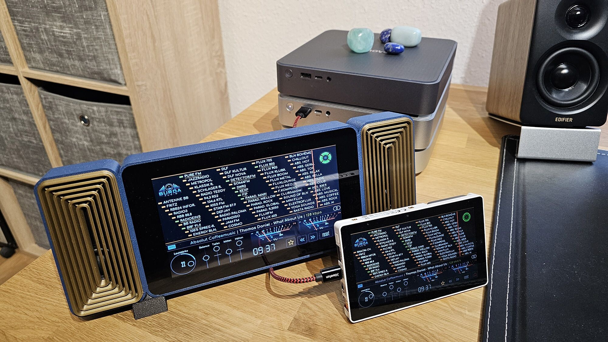
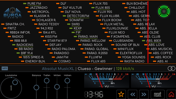
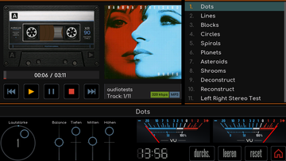
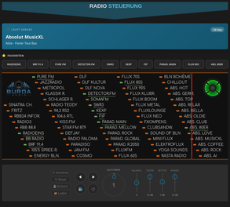

# RetroRadioTab5

[Dokumentation](#dokumentation) | [Erstinstallation](docs/RetroRadioTab5-Ersteinrichtung.md) | [Bedienung](docs/Bedienung.md) | [Radio und Musik](docs/Radio-und-Musik.md) | [Bluetooth-Sender](docs/Bluetooth-Sender.md)

Ein Internetradio mit dem Aussehen eines klassischen Tischradios für das **M5Stack Tab5**. Analogskala, magisches Auge, acht Visualisierungen und Musik von der SD-Karte laufen auf dem 5-Zoll-Touchdisplay mit 1280 x 720 Pixeln.

RetroRadioTab5 ist eine Teilportierung von [RetroRadio](https://github.com/DIYLAB-DE/RetroRadio), das Foto zeigt beide mit derselben Radioansicht nebeneinander. Radio, SD-Player, Hauptmenü, Einstellungen und Weboberfläche stammen aus dem Original. Zeichenwege, Schriften, Bilder und Bedienung wurden übernommen und werden ohne Skalierung in der vollen Auflösung des Tab5 gezeichnet. Das Tab5 braucht kein Gehäuse und keine Lötarbeiten, Display, Lautsprecher, Kopfhörerbuchse und SD-Kartenleser sind eingebaut. Wer Bluetooth-Kopfhörer, einen optischen Ausgang oder einen kleinen UKW-Sender möchte, ergänzt einen externen [Bluetooth-Sender](docs/Bluetooth-Sender.md).

## Dokumentation

| Thema | Anleitung |
| --- | --- |
| Installieren | [Windows, Linux und macOS mit VS Code/PlatformIO](docs/RetroRadioTab5-Ersteinrichtung.md), [PDF herunterladen](docs/RetroRadioTab5-Ersteinrichtung.pdf) |
| Benutzen | [Gerätebedienung](docs/Bedienung.md), [Radio und SD-Player](docs/Radio-und-Musik.md), [Weboberfläche und FTP](docs/Weboberfläche.md) |
| Erweitern | [Bluetooth-Sender mit optischem Ausgang und UKW-Modulator](docs/Bluetooth-Sender.md), [Verdrahtungsplan als PDF](docs/hardware/pläne/RetroRadioTab5-Verdrahtungsplan.pdf) |
| Fehler finden | [Fehlerhilfe](docs/Fehlerhilfe.md) |
| Versionen und Herkunft | [Änderungen](docs/Änderungen.md), [Lizenzen und Herkunft](docs/LIZENZEN.md) |

Die Anleitungen und Kommentare sind deutsch. Kleine Vorschaubilder öffnen die vollständigen Abbildungen. Die Dokumentation liegt direkt im Repository und ist mit dem jeweiligen Quellstand verfügbar.

## Radio und Musik

Das Internetradio zeigt 70 Senderplätze auf einer nachgebildeten Analogskala mit beweglichem Zeiger. Favoriten erleichtern die Auswahl der Lieblingssender. Vier magische Augen und acht Visualisierungen begleiten die Wiedergabe, das magische Auge zeigt im Stand die Stärke des WLAN-Empfangs. Lautstärke, Balance und Klang stellst Du direkt am Drehknopf und an den Schiebereglern ein.

Der SD-Player spielt Musik von der eingelegten microSD-Karte. Ordnerauswahl, Playlist mit Titel- und Listenwiederholung, Coveranzeige und acht animierte Kassetten gehören zur Bedienoberfläche.

Über die Weboberfläche im lokalen Netzwerk bedienst Du das Radio, pflegst und sortierst die Sender, verwaltest die Dateien auf der SD-Karte und wählst Thema und Farben. Zur Dateiübertragung steht auch FTP zur Verfügung.

| Radio | SD-Player | Weboberfläche |
| --- | --- | --- |
|  |  |  |

## Was RetroRadioTab5 kann

| Anwendung | Wofür Du sie nutzen kannst |
| --- | --- |
| Hauptmenü | Große Uhr mit Datum, WLAN-Anzeige und den drei Symbolen für Radio, SD-Player und Einstellungen. |
| Radio | Internetradio mit Analogskala, Favoriten, magischem Auge, Visualisierungen und Sleep-Timer. |
| SD-Player | Musik von der microSD-Karte mit Kassettenansicht, Cover, Playlist und Wiederholung. |
| Einstellungen | WLAN, Bluetooth, UKW, Zeit, Zeitfenster, Sprache, PIN-Sperre, Klang, Anzeige, Thema, Bildschirm und Geräteinformationen. |
| Weboberfläche | Fernbedienung, Senderpflege, Systemeinstellungen, Farben, Dateimanager mit FTP und Bildschirmaufnahme im Browser. |
| Bluetooth-Sender | Optionale Erweiterung für Bluetooth-Kopfhörer und -Lautsprecher, mit optischem Ausgang und UKW-Modulator. |

Drei Themen stehen zur Wahl: **Retro** mit den Farben des Originals, **E-Paper** in hellen Papiertönen und **Individuell** mit eigenen Farben aus der Weboberfläche. Für das Internetradio wird eine WLAN-Verbindung benötigt.

## Hardware

Gebraucht wird ein **M5Stack Tab5**. Die folgenden Angaben stammen vom Hersteller, die rechte Spalte nennt, wofür RetroRadioTab5 das jeweilige Bauteil nutzt.

| Bauteil | Herstellerangabe | In RetroRadioTab5 |
| --- | --- | --- |
| Prozessor | ESP32-P4, RISC-V mit zwei Kernen, 16 MB Flash, 32 MB PSRAM | Firmware, Bildaufbau und Audio |
| Display | 5 Zoll, IPS, 1280 x 720 Pixel, MIPI-DSI, kapazitiver Touch | Alle Ansichten im Querformat, Drehung um 180° |
| WLAN | ESP32-C6, 2,4 GHz, Wi-Fi 6 | Internetradio, Zeitabgleich, Weboberfläche und FTP |
| Audio | ES8388 mit 1-W-Lautsprecher und 3,5-mm-Kopfhörerbuchse | Wiedergabe über Lautsprecher oder Buchse |
| Speicher | microSD-Kartenleser | SD-Player, Dateimanager und FTP |
| Uhr | RTC RX8130CE | Uhrzeit auch ohne WLAN, Sender und Lautstärke über Neustarts |
| Lagesensor | BMI270 | Automatische Drehung des Bildes |
| Erweiterung | M5-Bus auf der Rückseite | Anschluss des optionalen Bluetooth-Senders |
| Anschlüsse | USB-C und USB-A | USB-C für Versorgung, Erstinstallation und Updates |

Kamera, Mikrofone und die USB-A-Buchse werden von RetroRadioTab5 nicht genutzt.

**Akku:** Das Tab5 gibt es ohne Akku (C145) und als Kit mit wechselbarem Akku NP-F550, 7,4 V und 2000 mAh (K145). Im Shop von M5Stack ist das Kit K145 auch ohne Akku erhältlich. RetroRadioTab5 läuft am USB-C-Anschluss, der Betrieb mit Akku ist nicht geprüft.

### Welche Tab5 laufen

M5Stack hat Display und Touch des Tab5 seit dem Marktstart zweimal gewechselt. Laut Hersteller ändert sich dabei nur der Treiber von Display und Touch, die übrige Hardware bleibt gleich. Welche Ausführung Du hast, nennt der Aufkleber auf der Rückseite mit dem Namen des Displaytreibers. Die [Tab5-Seite von M5Stack](https://docs.m5stack.com/en/core/Tab5) beschreibt den Wechsel.

| Ausführung | Displaytreiber | Touch | Unterschied | Mit RetroRadioTab5 |
| --- | --- | --- | --- | --- |
| Ab Marktstart am 09.05.2025 | ILI9881C | Eigener Touch-IC GT911 an I2C-Adresse 0x14 | Display und Touch in zwei Bausteinen | Entwicklungsgerät, alle Ansichten geprüft |
| Ab 14.10.2025 | ST7123 | Im Displaytreiber, I2C-Adresse 0x55 | Display und Touch in einem Baustein | Bild, Touch, Drehung, WLAN und Radio geprüft |
| Ab 28.04.2026 | ST7121 | ST7123-kompatibel, I2C-Adresse 0x55 | Neuer Displaytreiber, anderer Bildtakt | Bild, Touch, Drehung, WLAN und Radio mit Ton geprüft |

Es gibt nur eine Firmware für alle drei Ausführungen. Entscheidend ist außerdem die Chiprevision des ESP32-P4. RetroRadioTab5 ist für die Revisionen 0.x bis 1.x gebaut, alle drei geprüften Geräte haben Revision 1.0 oder 1.3. Ein Tab5 mit ESP32-P4 ab Revision 3.0 wird **nicht unterstützt**. Du musst die Revision nicht selbst herausfinden: Der Upload liest sie vor dem Schreiben aus und bricht bei einer unpassenden Revision ab, ohne etwas zu verändern.

### Ein Programm für alle Ausführungen

Beim Tab5 musst Du Dich beim Entwickeln nicht um die Ausführung kümmern. Die Bibliotheken M5GFX und M5Unified von M5Stack erkennen Display und Touch bei jedem Start selbst und stellen Bildtakt, Panel und Touch passend ein. Ein Programm läuft so ohne Änderung auf allen drei Ausführungen, auch RetroRadioTab5 enthält keinen eigenen Display- oder Touchtreiber. M5Stack empfiehlt dafür M5Unified ab 0.2.23 und M5GFX ab 0.2.30, RetroRadioTab5 verwendet M5Unified 0.2.26 und M5GFX 0.2.33. M5GFX baut auf LovyanGFX auf, der Grafikbibliothek, die auch RetroRadio verwendet.

### Beschaffung

Viele Händler nennen nicht, welche Ausführung sie liefern. Frage deshalb vor dem Kauf nach, wenn Du eine bestimmte Ausführung, etwa die neueste, haben möchtest. Gute Erfahrungen gibt es mit diesen Händlern:

- **Reichelt:** [Kit mit Akku, K145](https://www.reichelt.de/de/de/shop/produkt/m5stack_tab5_iot_entwickler-kit_mit_akku_esp32-p4_-415282), 60,80 EUR inklusive Mehrwertsteuer (Stand 08.11.2026). Eine Ausführung ohne Akku führt Reichelt nicht.
- **DigiKey:** [Tab5 ohne Akku, C145](https://www.digikey.de/de/products/detail/m5stack-technology-co-ltd/C145/26740595) und [Kit mit Akku, K145](https://www.digikey.de/de/products/detail/m5stack-technology-co-ltd/K145/26740594).

**Meine Erfahrung mit BerryBase:** Vor einer Bestellung wollte ich bei BerryBase wissen, welche Ausführung des Tab5 gerade ausgeliefert wird. Die Antwort: Der Händler fragt die Ausführung weder beim Hersteller ab noch hält er sie selbst fest und kann deshalb nichts Verbindliches sagen. Auch mein Hinweis, dass ein Blick auf den Aufkleber der Rückseite genügt, änderte daran nichts. Ich rate deshalb davon ab, das Tab5 bei BerryBase zu kaufen, dort bekommst Du die Katze im Sack. Die Einzelheiten stehen in [meiner Rezension](https://share.google/KDBOKXbPbd8CH5zxo).

Ein Tab5 mit ESP32-P4 ab Revision 3 läuft mit RetroRadioTab5 nicht. Die Bibliothek M5Unified kennt solche Geräte bereits unter dem Namen „Tab5X“. Ob und wann M5Stack sie ausliefert, ist offen.

### Hilfreiche Links

- [Tab5 in der M5Stack-Dokumentation](https://docs.m5stack.com/en/core/Tab5) mit Datenblättern, Pinbelegung und den Hinweisen zum Displaywechsel.
- [Tab5 im M5Stack-Shop](https://shop.m5stack.com/products/m5stack-tab5-iot-development-kit-esp32-p4), dort als Kit K145 mit oder ohne Akku.
- [M5Stamp Pico DIY Kit](https://docs.m5stack.com/en/core/stamp_pico_diy_kit) für den Bluetooth-Sender, der Programmieradapter liegt dem Kit bei, [bei DigiKey (K051-B)](https://www.digikey.de/de/products/detail/m5stack-technology-co-ltd/K051-B/14672109) und [im M5Stack-Shop](https://shop.m5stack.com/products/m5stamp-pico-diy-kit). Für mehrere Sender gibt es fünf Stamp Pico im Beutel [bei DigiKey (C050-B)](https://www.digikey.de/de/products/detail/m5stack-technology-co-ltd/C050-B/15667526), ein Programmieradapter ist dort nicht genannt.
- [ESP32 Downloader Kit](https://docs.m5stack.com/en/accessory/esp32_downloader_kit), der Programmieradapter auch einzeln, [im Shop](https://shop.m5stack.com/products/esp32-downloader-kit).
- [ESP32-A2DP](https://github.com/pschatzmann/ESP32-A2DP), die Bluetooth-Bibliothek der Pico-Firmware.

## Nachbau und Inbetriebnahme

Das Projekt lässt sich in Visual Studio Code mit PlatformIO öffnen, bearbeiten, bauen und auf das Tab5 übertragen. Es gibt eine Projektumgebung für alle Tab5: `tab5_basis`. Ein USB-C-Datenkabel zwischen Rechner und Tab5 genügt, ein Umschalter oder eine zweite Buchse ist nicht nötig.

Die [Anleitung zur ersten Inbetriebnahme](docs/RetroRadioTab5-Ersteinrichtung.md) führt durch die Installation unter Windows, Linux und macOS. Beim ersten Upload auf ein Tab5 mit Werksfirmware sichert der Upload zuerst den gesamten Flash auf Deinem Rechner. Diese Sicherung ist Dein Rückweg zur Werksfirmware. Spätere Updates schreiben nur noch die Firmware und lassen Einstellungen, Sender und WLAN-Zugangsdaten unberührt.

Nach dem ersten Start richtest Du WLAN, Uhrzeit und die PIN ein und legst eine microSD-Karte mit Musik ein. Der [Bluetooth-Sender](docs/Bluetooth-Sender.md) ist optional und kann jederzeit später ergänzt werden.

Die Versionsnummer steht in der Firmware fest und ändert sich nur mit einem Release. Ein eigener Build aus demselben Quellstand zeigt dieselbe Nummer. Was sich zwischen den Versionen geändert hat, steht unter [Änderungen](docs/Änderungen.md).

## Lizenz und Herkunft

Der RetroRadioTab5-Quellcode steht wie RetroRadio unter der [GPL-3.0](LICENSE). Enthaltene Bibliotheken, Schriften, Symbole und Bilder haben eigene Herkunfts- und Lizenzvermerke, die Übersicht steht in [LIZENZEN.md](docs/LIZENZEN.md).

Ein besonderer Dank geht an **Semir** aus dem RBF (Radio-Bastler-Forum). Er hat die UKW-Modulator-Baugruppe mit RDS bereitgestellt.

Danke an Wolle alias schreibfaul1 für ESP32-audioI2S als Grundlage der Audio-Bibliothek `audio-lite`, an N. Waldt für den EM34-Emulator, an dem sich die Optik der Abstimmröhren orientiert, an Phil Schatzmann für die Bibliothek ESP32-A2DP und an das Projekt Phosphor Icons für die verwendeten Symbole.

Danke an lovyan03 für LovyanGFX sowie die Tab5-Unterstützung in M5GFX und M5Unified, dank der eine Firmware auf allen Ausführungen läuft, und an die Entwickler von M5Stack, die diese Unterstützung weiterführen.

[Dokumentation](#dokumentation) | [Erstinstallation](docs/RetroRadioTab5-Ersteinrichtung.md) | [Bedienung](docs/Bedienung.md) | [Radio und Musik](docs/Radio-und-Musik.md) | [Bluetooth-Sender](docs/Bluetooth-Sender.md)
