# RetroRadioTab5 bedienen

[RetroRadioTab5](../README.md) > [Dokumentation](../README.md#dokumentation) > RetroRadioTab5 bedienen

Nach der [Erstinstallation](RetroRadioTab5-Ersteinrichtung.md) zeigt das Hauptmenü links eine große runde Uhr mit Datum. Im Zifferblatt stehen WLAN-Name, IP-Adresse und Empfangsbalken sowie die Marken **NTP** (Zeit über das Netz abgeglichen) und **DST** (Sommerzeit). Oben rechts öffnen drei Symbole von links nach rechts das Radio, den SD-Player und die Einstellungen. Ohne WLAN-Verbindung ist das Radiosymbol gesperrt.

[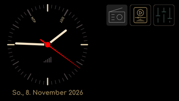](bilder/bedienung/hauptmenue.png)

Das Haus unten rechts führt aus jeder Anwendung zurück ins Hauptmenü. Bei Radio und SD-Player öffnet es zuerst den Sleep-Timer: Tippe dort erneut auf das Haus, um die Wiedergabe sofort zu beenden und ins Hauptmenü zu wechseln.

Ein kurzer Tipp wählt eine Taste oder ein Feld. Listen lassen sich mit dem Finger verschieben. Ein längerer Druck oder Wischen hat nur an den jeweils beschriebenen Stellen eine Zusatzfunktion. Eingabedialoge besitzen eigene Bestätigungs- und Abbruchmöglichkeiten.

## Radio, SD-Player und Weboberfläche

- [Radio und Musik](Radio-und-Musik.md): Sender, Favoriten, Klang, alle acht Visualisierungen, vier magische Augen, Sleep-Timer, Dateiauswahl, Cover, Kassetten und Wiederholung.
- [Weboberfläche](Weboberfläche.md): Bedienung und Verwaltung im Browser, einschließlich Senderpflege, Sortieren der 70 Senderplätze, Farben, SD-Dateien und FTP.
- [Bluetooth-Sender](Bluetooth-Sender.md): Kopfhörer und Lautsprecher koppeln, optischer Ausgang und UKW-Modulator.

## Einstellungen

Das rechte Symbol mit den Schiebereglern öffnet die Einstellungen. Links wählst Du die Seite, rechts bearbeitest Du ihre Felder. Die Seiten sind in die Abschnitte **Verbindung** und **System** gegliedert. Längere Texte gibst Du über eine Bildschirmtastatur mit deutscher und englischer Belegung ein, Zahlen über die angezeigten Zahlentasten oder mit Minus und Plus.

Änderungen gelten erst mit **speichern** unten in der Fußzeile. Verlässt Du die Einstellungen mit offenen Änderungen über das Haus, fragt der Dialog **Ungespeicherte Änderungen** nach, ob Du speichern oder verwerfen möchtest. Persönliche Netzwerkangaben sind in den Beispielbildern absichtlich unscharf.

| Seite | Bedienung | Beispiel |
| --- | --- | --- |
| WLAN | Drei Profile einzeln aktivieren, Netze **scannen**, **passwort** eingeben, Verbindung **test**en, Profil **löschen** und den Netzwerknamen des Tab5 ändern. | [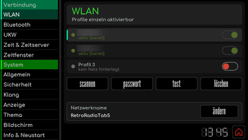](bilder/bedienung/einstellungen-wlan.png) |
| Bluetooth | Kopfhörer und Lautsprecher über den optionalen [Bluetooth-Sender](Bluetooth-Sender.md#koppeln) **suchen**, verbinden, **test**en und **vergessen**. | [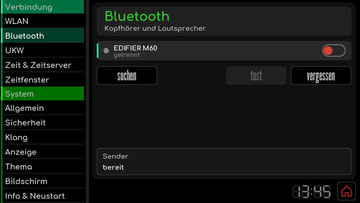](bilder/bedienung/einstellungen-bluetooth.png) |
| UKW | Den optionalen [UKW-Modulator](Bluetooth-Sender.md#ukw-modulator) ein- und ausschalten, Frequenz und Leistung wählen. | [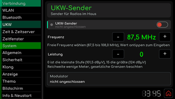](bilder/bedienung/einstellungen-ukw.png) |
| Zeit & Zeitserver | Zeitzone, Zeitserver und Sync-Intervall einstellen, bei Bedarf die Uhrzeit von Hand setzen. | [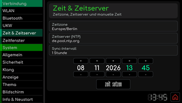](bilder/bedienung/einstellungen-zeit.png) |
| Zeitfenster | Betriebszeiten für jeden Wochentag und jede volle Stunde festlegen. | [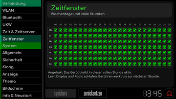](bilder/bedienung/einstellungen-zeitfenster.png) |
| Allgemein | Deutsch oder Englisch auswählen und die serielle Protokollausgabe über USB ein- oder ausschalten. | [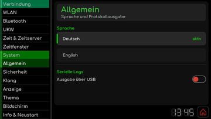](bilder/bedienung/einstellungen-allgemein.png) |
| Sicherheit | PIN-Sperre für Radio und Weboberfläche ein- oder ausschalten und den vierstelligen Code ändern. | [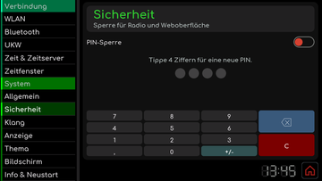](bilder/bedienung/einstellungen-sicherheit.png) |
| Klang | Eckfrequenzen von Tiefen, Mitten und Höhen, Basisbreite, Loudness und Lautsprecher einstellen. | [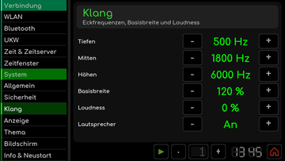](bilder/bedienung/einstellungen-klang.png) |
| Anzeige | Bauform des magischen Auges sowie Zeigerträgheit und Bezugspegel der analogen VU-Meter wählen. | [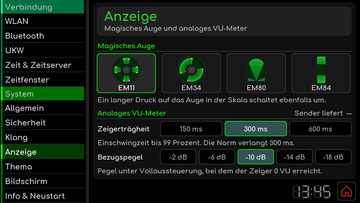](bilder/bedienung/einstellungen-anzeige.png) |
| Thema | Zwischen Retro, E-Paper und Individuell wählen, jede Zeile zeigt eine kleine Vorschau. | [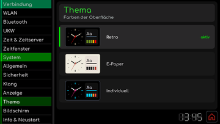](bilder/bedienung/einstellungen-thema.png) |
| Bildschirm | Helligkeit, automatische Drehung und feste Ausrichtung einstellen. | [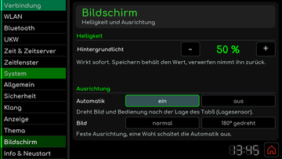](bilder/bedienung/einstellungen-bildschirm.png) |
| Info & Neustart | Netzwerk- und Geräteinformationen lesen, Neustart oder Zurücksetzen gezielt auslösen. | [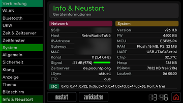](bilder/bedienung/einstellungen-info.png) |

### WLAN

Wähle ein Profil, tippe auf **scannen** und wähle Dein Netz in der Liste. Über **passwort** gibst Du das Passwort ein, **test** prüft die Verbindung und zeigt bei Erfolg IP-Adresse und Signalstärke. Aktiviere das Profil mit seinem Schalter und tippe auf **speichern**. Der anschließende Dialog bietet **neustart** an. Beim Start verbindet das Tab5 die aktivierten Profile der Reihe nach, bis eines erreichbar ist. Unterstützt werden Netze im 2,4-GHz-Band.

Unter **Netzwerkname** änderst Du den Namen, mit dem sich das Tab5 im Netzwerk meldet. Erlaubt sind 1 bis 32 Buchstaben, Ziffern und Bindestriche.

### Zeit und Zeitfenster

Auf der Seite **Zeit & Zeitserver** wählst Du Zeitzone, Zeitserver und das Sync-Intervall. Nach jeder neuen WLAN-Verbindung gleicht das Tab5 die Uhrzeit mit dem Zeitserver ab und schreibt sie in seine eingebaute Uhr. Ohne Netz läuft die Uhr dort weiter. **zeit setzen** stellt die Uhr von Hand, der nächste Abgleich mit dem Zeitserver kann sie wieder ändern.

Die Seite **Zeitfenster** zeigt eine Wochenübersicht mit einem Kästchen je Wochentag und voller Stunde. Angehakt bleibt das Gerät in dieser Stunde aktiv. In einer leeren Stunde stoppt die Wiedergabe, das Tab5 wechselt ins Hauptmenü, sperrt sich bei eingeschalteter PIN-Sperre und schaltet die Beleuchtung aus. Eine Berührung weckt es bis zur nächsten vollen Stunde. Die Zeitfenster wirken nur bei gültiger Uhrzeit.

### Allgemein

Unter **Sprache** wählst Du Deutsch oder English. Die neue Sprache gilt nach dem Speichern und einem Neustart, den der Dialog **Sprache ändern** anbietet.

Unter **Serielle Logs** schaltet **Ausgabe über USB** die Diagnosemeldungen für den seriellen Monitor ein oder aus. Die Änderung wirkt sofort, wird automatisch gespeichert und bleibt nach einem Neustart erhalten. Ab Werk und nach dem Zurücksetzen auf Werkseinstellungen ist die Ausgabe ausgeschaltet.

### Klang

Die Seite **Klang** legt fest, wie die Regler in Radio und SD-Player wirken. **Tiefen**, **Mitten** und **Höhen** wählen die Eckfrequenzen der drei Klangregler. **Basisbreite** verbreitert oder verengt das Stereobild, **Loudness** hebt bei geringer Lautstärke Tiefen und Höhen an. Die Werte wirken sofort als Vorschau, **speichern** übernimmt sie, beim Verwerfen gilt wieder der gespeicherte Stand. Lautstärke, Balance und die Pegel der drei Klangregler selbst stellst Du direkt im [Radio](Radio-und-Musik.md#internetradio) ein.

Der eingebaute Lautsprecher ist mono, die Basisbreite ist deshalb nur über die Kopfhörerbuchse zu hören. Steckt ein Kopfhörer, schweigt der Lautsprecher. **Lautsprecher** **Aus** schaltet allen Ton ab, auch an der Kopfhörerbuchse und über den Bluetooth-Sender.

### Anzeige, Thema und Bildschirm

Auf der Seite **Anzeige** wählst Du die Bauform des magischen Auges: **EM11**, **EM34**, **EM80** oder **EM84**. Ein langer Druck auf das Auge in der Radioskala schaltet ebenfalls um. Für die analogen VU-Meter stellst Du die **Zeigerträgheit** und den **Bezugspegel** ein, bei dem der Zeiger 0 VU erreicht.

Die Seite **Thema** bietet **Retro**, **E-Paper** und **Individuell**. Jede Zeile zeigt eine kleine Vorschau aus den Farben ihres Themas, **aktiv** markiert das laufende. Nach dem Speichern fragt der Dialog **Thema ändern** nach einem Neustart, denn das neue Thema gilt erst danach. Die Farben von **Individuell** stellst Du in der [Weboberfläche](Weboberfläche.md#thema-und-farben) ein.

| Thema | Hauptmenü | Radio | SD-Player |
| --- | --- | --- | --- |
| Retro |  | [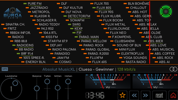](bilder/bedienung/radio-uebersicht.png) | [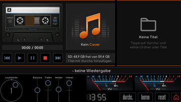](bilder/bedienung/sdplayer-uebersicht.png) |
| E-Paper | [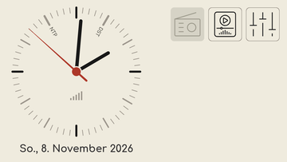](bilder/bedienung/hauptmenue-epaper.png) | [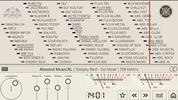](bilder/bedienung/radio-uebersicht-epaper.png) | [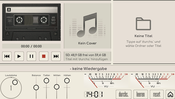](bilder/bedienung/sdplayer-uebersicht-epaper.png) |
| Individuell | [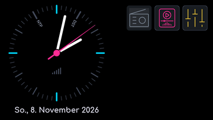](bilder/bedienung/hauptmenue-individuell.png) | [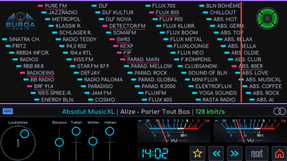](bilder/bedienung/radio-uebersicht-individuell.png) | [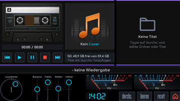](bilder/bedienung/sdplayer-uebersicht-individuell.png) |

| Themenwahl in E-Paper | Themenwahl in Individuell |
| --- | --- |
| [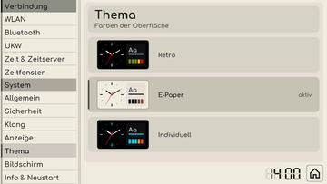](bilder/bedienung/einstellungen-thema-epaper.png) | [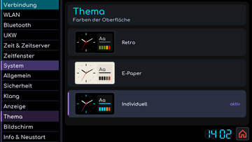](bilder/bedienung/einstellungen-thema-individuell.png) |

Auf der Seite **Bildschirm** stellst Du das **Hintergrundlicht** in Zehnerschritten von 10 bis 100 Prozent ein. Ab Werk sind es 40 Prozent. Unter **Ausrichtung** dreht **Automatik** **ein** Bild und Bedienung nach der Lage des Tab5. Eine feste Wahl, **normal** oder **180° gedreht**, schaltet die Automatik aus. Beides wirkt sofort als Vorschau, **speichern** behält die Werte.

### Info & Neustart

Die Seite **Info & Neustart** zeigt unter **Netzwerk** WLAN-Name, Netzwerkname, IP-Adresse, Gateway, Signal, MAC-Adresse, Kanal, Zeitserver, den letzten Abgleich und den Zustand von FTP. Unter **System** stehen Prozessor, Speicher, Firmwaregröße, freier Arbeitsspeicher, die angeschlossenen I2C-Geräte und die Chiptemperatur. Die **Version** ist die Nummer des installierten Release. Die Zeile **FTP** zeigt **aus** oder **an** samt Adresse, das Passwort steht nur in der Weboberfläche.

**neustart** startet das Tab5 nach einer Rückfrage neu. **zurücksetzen** stellt nach einer Rückfrage die Werkseinstellungen her: Alle WLAN-Profile und Einstellungen gehen dabei verloren. Es ist kein normaler Schritt bei einem Firmware-Update.

## Sperren und Entsperren

Ab Werk ist die **PIN-Sperre** eingeschaltet, die Start-PIN lautet **`0000`**. Ist sie eingeschaltet, sperrt sich das Tab5 nach jedem Start, beim Aufwecken aus einem Zeitfenster und mit einer Geste im Hauptmenü: Wische an einer der beiden linken Ecken diagonal in die Ecke hinein oder aus ihr heraus. Auf dem Sperrbildschirm blendet ein Tipp das Tastenfeld ein. Gib die vier Ziffern ein und bestätige mit **ok**, **c** löscht die Eingabe.

| Gesperrt | Code eingeben |
| --- | --- |
|  | [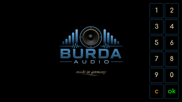](bilder/bedienung/geraet-sperrcode.png) |

Unter **Einstellungen -> Sicherheit** kannst Du die PIN ändern oder die Sperre ausschalten:

- **PIN ändern:** Tippe vier Ziffern für die neue PIN, wiederhole sie und bestätige mit **speichern**. Der Dialog **PIN geändert** meldet den Erfolg.
- **Sperre ausschalten:** Tippe auf den Schalter **PIN-Sperre** und gib einmal Deine aktuelle PIN ein. Eine falsche PIN lässt die Sperre an. Ohne Sperre öffnen Start und Aufwecken direkt das Hauptmenü, die Ecken-Geste sperrt nicht, und die Weboberfläche öffnet sich ohne PIN.
- **Sperre einschalten:** Ein Tipp auf den Schalter genügt, es gilt wieder Deine bisherige PIN.

Der Schalter wirkt sofort ohne **speichern** und gilt gemeinsam für das Display und die [Weboberfläche](Weboberfläche.md). Wie Du die Weboberfläche im Netzwerk schützt, steht unter [Netzwerkzugriff](Weboberfläche.md#netzwerkzugriff).

Bei unerwartetem Verhalten hilft die [Fehlerhilfe](Fehlerhilfe.md). Installation und Updates stehen in der [Erstinstallation](RetroRadioTab5-Ersteinrichtung.md).

[RetroRadioTab5](../README.md) > [Dokumentation](../README.md#dokumentation) > RetroRadioTab5 bedienen
