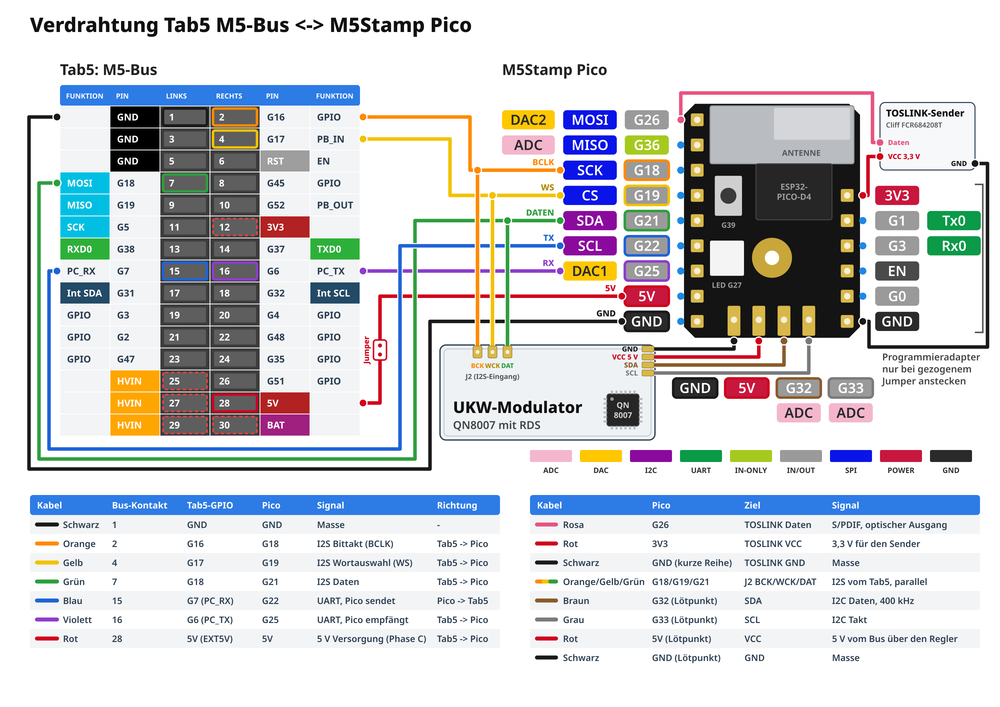
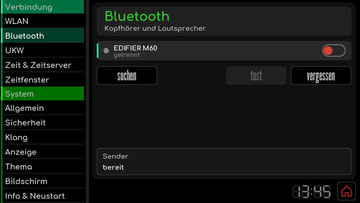
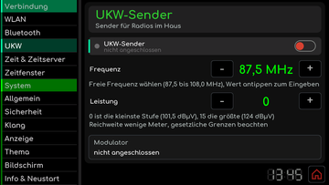

# Bluetooth-Sender

[RetroRadioTab5](../README.md) > [Dokumentation](../README.md#dokumentation) > Bluetooth-Sender

Das Tab5 funkt WLAN über seinen ESP32-C6. Dieser Chip kann nur Bluetooth LE, Kopfhörer und Lautsprecher brauchen für Musik aber klassisches Bluetooth mit dem Audioprofil A2DP. Deshalb übernimmt ein kleiner externer ESP32 diese Aufgabe: ein **M5Stamp Pico** aus dem Stamp Pico DIY Kit. Das Tab5 liefert ihm den Ton über I2S und steuert ihn über eine serielle Leitung, beides über den M5-Bus auf der Rückseite. Bedient wird alles am Tab5 unter **Einstellungen -> Bluetooth** und **Einstellungen -> UKW**.

Der Pico kann drei Dinge, die sich frei kombinieren lassen:

- **Bluetooth:** Ton an einen Bluetooth-Kopfhörer oder -Lautsprecher, die Lautstärke regelt der Drehknopf des Tab5.
- **Optischer Ausgang:** ein TOSLINK-Sender am Pico gibt den Ton als S/PDIF an eine Anlage weiter.
- **UKW-Modulator:** eine kleine Senderbaugruppe mit dem Chip QN8007 sendet den Ton samt RDS-Text an Radios im Haus.

Ohne Pico läuft RetroRadioTab5 ganz normal, die beiden Einstellungsseiten zeigen dann **nicht verfügbar** beziehungsweise **nicht angeschlossen**.

## Prüfstand

| Funktion | Stand |
| --- | --- |
| Suchen, Koppeln, Verbinden, Trennen und Vergessen auf der Einstellungsseite | Am Gerät mit einem Bluetooth-Kopfhörer geprüft |
| Ton aus Radio und SD-Player über den Kopfhörer, Lautstärke am Drehknopf | Am Gerät mit einem Bluetooth-Kopfhörer geprüft |
| Wiederverbindung mit dem gespeicherten Kopfhörer nach einem Neustart | Neustart von Pico und Tab5 geprüft, ein Stromausfall des Tab5 nicht |
| Versorgung des Pico über den M5-Bus | Am Gerät geprüft |
| Bluetooth-Lautsprecher statt Kopfhörer | Nicht geprüft |
| Optischer Ausgang | Der Pico sendet am Ausgang, an einem Empfänger ist der Ton noch nicht geprüft |
| UKW-Modulator | Firmware und Einstellungsseite fertig, ohne Baugruppe geprüft. Ton, RDS und Reichweite mit der Baugruppe sind noch nicht geprüft |
| Pico flashen | Unter Linux geprüft, Windows und macOS nicht |

## Bauteile

| Bauteil | Zweck |
| --- | --- |
| [M5Stamp Pico DIY Kit](https://docs.m5stack.com/en/core/stamp_pico_diy_kit), K051-B, etwa [bei DigiKey](https://www.digikey.de/de/products/detail/m5stack-technology-co-ltd/K051-B/14672109) | Der Pico mit ESP32-PICO-D4, Stiftleisten und dem Programmieradapter [ESP32 Downloader](https://docs.m5stack.com/en/accessory/esp32_downloader_kit) |
| Stiftleiste 2 x 15, Raster 2,54 mm | Steckt in der M5-Bus-Buchse des Tab5 und nimmt die Kabel auf |
| Dupont-Kabel, bis etwa 20 cm | Verbindungen zwischen M5-Bus und Pico |
| Jumper (Steckbrücke) | Trennstelle in der 5-V-Leitung, damit der Pico später gefahrlos am Programmieradapter geflasht werden kann |
| USB-Datenkabel | Rechner zum Programmieradapter, ein reines Ladekabel reicht nicht |
| TOSLINK-Sender, etwa Cliff FCR684208T (optional) | Optischer Ausgang |
| UKW-Modulator-Baugruppe mit QN8007 und RDS (optional) | UKW-Sender für Radios im Haus |

Wer mehrere Sender baut, bekommt fünf Stamp Pico im Beutel als C050-B, etwa [bei DigiKey](https://www.digikey.de/de/products/detail/m5stack-technology-co-ltd/C050-B/15667526). Ein Programmieradapter ist dort nicht genannt, einer aus einem DIY Kit oder ein einzelnes [ESP32 Downloader Kit](https://docs.m5stack.com/en/accessory/esp32_downloader_kit) reicht für alle. Die Baugruppe für den UKW-Modulator ist kein Handelsprodukt, eine Bezugsquelle gibt es derzeit nicht.

## Verdrahtung

[](hardware/pläne/RetroRadioTab5-Verdrahtungsplan.png)

Der Plan steht auch als [PDF im Format A4 quer zum Herunterladen](hardware/pläne/RetroRadioTab5-Verdrahtungsplan.pdf) und als [SVG zum Bearbeiten](hardware/pläne/RetroRadioTab5-Verdrahtungsplan.svg) bereit. Die Kabelfarben sind Vorschläge. Die Belegung des M5-Bus stammt aus der Dokumentation und dem Schaltplan von M5Stack.

| Kabel | M5-Bus-Kontakt | Tab5 | Pico | Signal |
| --- | --- | --- | --- | --- |
| Schwarz | 1 | GND | GND, lange Reihe, letzter Kontakt | Masse |
| Orange | 2 | G16 | G18 | I2S-Bittakt |
| Gelb | 4 | G17 | G19 | I2S-Wortauswahl |
| Grün | 7 | G18 | G21 | I2S-Daten |
| Blau | 15 | G7 | G22 | Pico sendet zum Tab5 |
| Violett | 16 | G6 | G25 | Tab5 sendet zum Pico |
| Rot, mit Jumper | 28 | 5V | 5V, lange Reihe, vorletzter Kontakt | Versorgung des Pico |

Der **TOSLINK-Sender** bekommt seine Daten von G26 des Pico und seine Versorgung von 3V3 und GND des Pico. Die **UKW-Baugruppe** hört an ihrem Eingang J2 die drei I2S-Leitungen parallel zum Pico mit (BCK an G18, WCK an G19, DAT an G21). Ihre Steuerleitungen kommen an die Lötpunkte auf der Unterseite des Pico: SDA an G32, SCL an G33, VCC an 5V und GND an GND.

> **Diese Kontakte bleiben frei:** Kontakt 12 (3V3, die Hauptversorgung des Tab5), Kontakt 6 (Reset) sowie 25, 27, 29 (HVIN) und 30 (BAT). Steckt ein Akku im Tab5, können HVIN und BAT auch im ausgeschalteten Zustand Spannung führen. Berühre sie nie, auch nicht mit einer Messspitze.

So gehst Du vor:

1. Schalte das Tab5 aus (Ein-/Aus-Taste zweimal drücken), ziehe sein USB-Kabel und ziehe den Programmieradapter vom Rechner ab.
2. Stecke die Stiftleiste in die M5-Bus-Buchse. Neben der Buchse ist die Belegung aufgedruckt: GND (1, 3, 5) am einen Ende, HVIN, 5V und BAT (25 bis 30) am anderen.
3. Wer ein Multimeter hat, prüft die Zählung vorher: Tab5 einschalten, schwarze Spitze an Kontakt 1, rote an Kontakt 12. Es müssen etwa 3,3 V anliegen. Danach das Tab5 wieder ausschalten.
4. Zuerst die Masse verbinden, dann die fünf Signalleitungen. Sieh Dir jedes Kabel an beiden Enden an und hake es in der Tabelle ab.
5. Zuletzt die rote 5-V-Leitung mit dem Jumper darin. Der Programmieradapter ist dabei nicht am Pico.
6. Tab5 einschalten. Nach einigen Sekunden zeigt **Einstellungen -> Bluetooth** im Feld **Sender** den Zustand **bereit**.

Abbauen in umgekehrter Reihenfolge: Tab5 aus, Adapter ab, dann 5 V und Signale ziehen, Masse zuletzt.

> **Nie Programmieradapter und Bus-5-V gleichzeitig am Pico.** Der Adapter versorgt den Pico mit eigenen 3,3 V. Mit gestecktem Jumper hätte der Pico zwei Versorgungen gegeneinander. Ziehe deshalb immer zuerst den Jumper, bevor Du den Adapter ansteckst.

## Pico flashen

Der Pico bekommt seine Firmware aus dem Unterordner [`bt-sender`](../bt-sender/README.md) dieses Projekts. Am einfachsten flashst Du ihn, bevor Du ihn verdrahtest. PlatformIO und das Projekt richtest Du dafür wie in der [Erstinstallation](RetroRadioTab5-Ersteinrichtung.md) ein.

1. Stecke den Programmieradapter auf die kurze Sechserreihe des Pico (3V3, G1, G3, EN, G0, GND) und verbinde ihn per USB-Datenkabel mit dem Rechner. Hängt der Pico schon am Tab5, ziehe vorher den Jumper.
2. Öffne in VS Code über die Befehlspalette **PlatformIO: New Terminal** und zeige die seriellen Geräte an:

   ```text
   pio device list
   ```

   Der Adapter erscheint unter Linux etwa als `/dev/ttyACM0` oder `/dev/ttyUSB0`, unter Windows als `COM`-Anschluss und unter macOS als `/dev/cu.`-Anschluss. Je nach Fertigung steckt im Adapter ein CH9102F oder ein CP2104. Erscheint unter Windows oder macOS kein Anschluss, installiere den passenden Treiber, die [Seite des Adapters](https://docs.m5stack.com/en/accessory/esp32_downloader_kit) nennt beide.
3. Baue und übertrage die Firmware. **Ersetze den Anschluss durch den tatsächlich angezeigten.** Verwende hier nie den Anschluss des Tab5.

   ```text
   pio run -d bt-sender -t upload --upload-port /dev/ttyACM0
   ```

4. Warte auf **SUCCESS**. Der Adapter schaltet den Pico selbst in den Download-Modus, ein Tastendruck ist nicht nötig. Eine gespeicherte Kopplung bleibt beim Flashen erhalten.
5. Ziehe den Adapter vom Pico ab. Hängt der Pico am Tab5, stecke erst danach den Jumper wieder und starte das Tab5 neu.

Wer die Startmeldungen sehen möchte, liest sie bei gestecktem Adapter mit `pio device monitor -d bt-sender --port /dev/ttyACM0` mit. Die erste Zeile beginnt mit `START RetroRadio`.

## Koppeln

Die Seite **Einstellungen -> Bluetooth** zeigt oben das gespeicherte Gerät mit seinem Zustand und einem Schalter, darunter die Tasten **suchen**, **test** und **vergessen**. Das Feld **Sender** zeigt, ob der Pico **bereit** oder **nicht angeschlossen** ist. Der Pico wird wenige Sekunden nach dem Start des Tab5 erkannt.

[](bilder/bedienung/einstellungen-bluetooth.png)

1. Bringe den Kopfhörer oder Lautsprecher in Kopplungsbereitschaft, meist durch langes Halten der Ein-Taste, bis die LED blinkt.
2. Tippe auf **suchen**. Nach etwa zehn Sekunden zeigt die Liste **Gerät wählen:** die gefundenen Geräte mit Signalstärke, das stärkste ist vorgewählt. **scan** sucht erneut, das Kreuz bricht ab.
3. Wähle Dein Gerät und tippe auf **ok**. Der Dialog **Bluetooth-Verbindung** zeigt den Fortschritt und meldet am Ende **Verbunden** oder **Keine Verbindung**.
4. Die Kopplung bleibt im Pico gespeichert. Kopfhörer koppeln in der Regel ohne PIN, ältere Geräte fragen nach **1234**.

Danach schaltet der Schalter in der Gerätezeile die Verbindung ein und aus. **test** spielt bei bestehender Verbindung drei Sekunden lang einen leisen Ton. **vergessen** löscht nach einer Rückfrage die Kopplung im Pico, für eine neue Kopplung muss das Gerät wieder in Kopplungsbereitschaft. **suchen** geht nur, solange keine Verbindung besteht, trenne sie vorher mit dem Schalter.

Nach einem Neustart wartet der Pico kurz auf den gespeicherten Kopfhörer und ruft ihn dann bis zu dreimal an. Der Kopfhörer muss dafür nur eingeschaltet sein. Meldet er sich später von selbst, nimmt der Pico ihn an. Andere Geräte weist er ab. Gegenüber Kopfhörern und Lautsprechern heißt der Pico **RetroRadio** mit sechs Zeichen seiner Adresse dahinter, so lassen sich mehrere Sender unterscheiden.

### Was sich mit Bluetooth ändert

- Solange ein Bluetooth-Gerät verbunden ist, schweigen Lautsprecher und Kopfhörerbuchse des Tab5.
- Der Drehknopf in Radio und SD-Player zeigt und regelt die Lautstärke des Bluetooth-Geräts. Drückst Du eine Lautstärketaste am Kopfhörer, folgt der Knopf. Das setzt voraus, dass das Gerät seine Lautstärke meldet. Nach dem Trennen steht der Knopf wieder auf der Lautsprecherlautstärke.
- Bluetooth verzögert den Ton um einen Bruchteil einer Sekunde. Visualisierungen und VU-Meter laufen dem Ton dann leicht voraus.
- **Einstellungen -> Klang -> Lautsprecher** **Aus** schaltet auch den Ton zum Bluetooth-Gerät ab.

## Optischer Ausgang

Mit einem TOSLINK-Sender an G26 gibt der Pico den Ton als S/PDIF aus. Der Ausgang ist immer an, ohne Schalter. Er trägt, was der Lautsprecher spielt, mit der Lautstärke des Drehknopfs. Ist ein Bluetooth-Kopfhörer verbunden, kommt der optische Ausgang mit voller Lautstärke. Der Lautsprecher des Tab5 spielt weiter, es sei denn, Du schaltest ihn ab oder ein Kopfhörer steckt.

Die optische Abtastrate folgt der Quelle, meist 44,1 oder 48 kHz. Niedrigere Raten verdoppelt der Pico, höhere halbiert er, damit gängige Empfänger einrasten. Ohne Ton sendet er Stille, damit der Empfänger nicht abschaltet.

## UKW-Modulator

Mit der UKW-Baugruppe sendet der Pico den Ton auf einer UKW-Frequenz. Radios im Haus zeigen dazu per RDS den Sendernamen und den laufenden Titel, beim SD-Player in der Form Interpret - Titel.

[](bilder/bedienung/einstellungen-ukw.png)

Auf der Seite **Einstellungen -> UKW** schaltest Du den **UKW-Sender** mit seinem Schalter ein. **Frequenz** reicht von 87,5 bis 108,0 MHz in Schritten von 0,1 MHz, ein Tipp auf den Wert öffnet die Tastatur. Wähle eine freie Frequenz, auf der kein anderer Sender zu hören ist. **Leistung** reicht von Stufe 0 bis 15. Ab Werk sind der Sender aus, 87,5 MHz und Stufe 0 eingestellt. Alle Änderungen wirken sofort, **speichern** behält sie über einen Neustart. Das Feld **Modulator** zeigt, ob die Baugruppe erkannt wurde und ob sie RDS kann.

Die Zeile unter dem Namen zeigt den Zustand, etwa **sendet auf 101,3 MHz**. Steht dort **stumm**, ist das Tab5 stumm geschaltet oder die Abtastrate der Quelle passt nicht: Der Chip nimmt nur 32, 40, 44,1 und 48 kHz an. Die Lautstärke folgt wie beim optischen Ausgang dem Drehknopf.

> **Reichweite und Vorschriften:** Die Baugruppe ist für wenige Meter gedacht. Halte die Leistung so klein wie möglich und beachte die gesetzlichen Grenzen für den Betrieb von UKW-Sendern in Deinem Land.

## Technische Beschreibung

Anschlüsse, I2S-Format und das vollständige serielle Protokoll des Pico stehen in der [README des Unterprojekts](../bt-sender/README.md). Damit lässt sich der Pico auch an anderen Geräten mit 3,3-V-UART und I2S betreiben.

[Zur Gerätebedienung](Bedienung.md) | [Fehlerhilfe](Fehlerhilfe.md)

[RetroRadioTab5](../README.md) > [Dokumentation](../README.md#dokumentation) > Bluetooth-Sender
