# Radio und Musik

[RetroRadioTab5](../README.md) > [Dokumentation](../README.md#dokumentation) > Radio und Musik

[Zur allgemeinen Bedienung](Bedienung.md)

## Internetradio

Öffne im Hauptmenü das Radiosymbol. Die große Analogskala zeigt die 70 Senderplätze, der rote Zeiger fährt zum ausgewählten Sender. Ein Tipp auf einen Sendernamen wählt ihn aus, der neue Sender startet, sobald der Zeiger angekommen ist. Favoriten sind unterstrichen. Unten stehen Lautstärke, Balance und die drei Klangregler. Die Pfeiltasten wechseln zum vorherigen oder nächsten Sender. Der Stern öffnet die Favoriten.

| Radio | Favoriten | Sleep-Timer |
| --- | --- | --- |
|  | [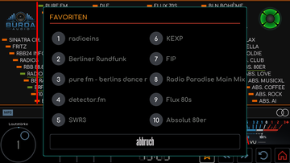](bilder/bedienung/radio-senderspeicher.png) | [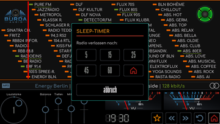](bilder/bedienung/radio-sleeptimer.png) |

Die Infozeile unter der Skala zeigt Sendername, Titel und Bitrate. Links erscheint das erkannte Audioformat, beispielsweise MP3, AAC, Vorbis oder FLAC. Beim Senderwechsel wird das bisherige Format ausgeblendet, bis das neue erkannt wurde. Das Stereo-Symbol rechts folgt der tatsächlichen Mono-Erkennung des Audiosignals, kurze Schwankungen unter einer halben Sekunde ändern die Anzeige nicht.

Bricht ein Stream ab, zeigt die Infozeile **Stream unterbrochen**. Das Radio startet den Sender dann selbst neu, zuerst nach wenigen Sekunden, danach alle 30 Sekunden, bis er wieder spielt.

### Lautstärke und Klang

Der Lautstärkeknopf reicht von 0 bis 100 und reagiert auf eine Drehbewegung am äußeren Bereich. Die Markierung folgt dabei Deinem Finger. Ein Tipp in die Mitte schaltet stumm beziehungsweise hebt die Stummschaltung auf. Auch beim Herunterdrehen auf Lautstärke null erscheint das Mute-Symbol und die Visualisierungen gehen auf null. Durch Hochdrehen wird die Wiedergabe wieder hörbar, sofern sie nicht zusätzlich per Tipp stummgeschaltet wurde. Ist ein Bluetooth-Kopfhörer verbunden, regelt der Knopf dessen Lautstärke.

Balance (-16 bis 16) sowie Tiefen, Mitten und Höhen (je -12 bis 12 dB) stellst Du durch Ziehen der Schieberegler ein. Bei welchen Frequenzen die drei Klangregler ansetzen, legst Du unter [Einstellungen -> Klang](Bedienung.md#klang) fest. Sendernamen, Streamadressen und Favoriten pflegst Du in der [Weboberfläche](Weboberfläche.md#radiosteuerung-und-senderpflege).

[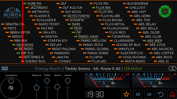](bilder/bedienung/radio-lautstaerke-null.png)

Die Taste mit dem **Kreispfeil** öffnet die Rückfrage **ZURÜCKSETZEN?**. Mit **weiter** gehen Lautstärke (auf 30), Balance, Klangregler und die Varianten der Visualisierungen auf ihre Grundeinstellung zurück, **abbruch** lässt alles, wie es ist. Die Taste nicht mit dem normalen Beenden verwechseln.

### Favoriten und Sleep-Timer

Der Stern öffnet **FAVORITEN** mit bis zu zehn markierten Sendern. Ein Tipp startet den Sender, **abbruch** schließt den Dialog. Welche Sender Favoriten sind, legst Du in der [Weboberfläche](Weboberfläche.md#radiosteuerung-und-senderpflege) fest.

Das Haus unten rechts öffnet den **SLEEP-TIMER** mit **5, 15, 25, 45 und 60 Minuten**. Ein Tipp auf das Haus im Dialog beendet die Wiedergabe sofort und führt zurück ins Hauptmenü. **abbruch** schließt den Dialog. Nach Auswahl einer Zeit läuft die Wiedergabe bis zum Ablauf weiter, die Uhr zeigt die Restzeit. Ein laufender Timer lässt sich im selben Dialog mit **stopp** beenden. Ist die Zeit abgelaufen, schalten sich Ton und Display aus. Eine Berührung weckt das Tab5, bei eingeschalteter PIN-Sperre folgt zuerst der Sperrbildschirm. Die Dialoge schließen sich nach zehn Sekunden ohne Berührung von selbst.

## Alle acht Visualisierungen

**Im Visualisierungsbereich waagerecht wischen**, um den Modus zu wechseln. **Länger als etwa eine Sekunde drücken**, um innerhalb des Modus die zweite Darstellung auszuwählen. Alle acht Modi bieten zwei Varianten:

- **Analoges VU-Meter:** zwei Zeigerinstrumente mit klassischer oder grüner Skala.
- **Digitales VU-Meter:** Leuchtbalken in Grün oder mit einem Farbverlauf von Grün bis Rot.
- **Spektrumanalysator:** 63 Frequenzbänder in Grün oder im Farbverlauf.
- **Wellenform:** eine fortlaufende Zeitspur der letzten gut fünf Sekunden, beide Kanäle übereinander oder getrennt, links oben und rechts unten.
- **Goniometer:** die Stereofigur mit Pegelbalken und kleiner Uhr. Die zweite Variante färbt nur die Pegelbalken von Grün bis Rot, die Figur bleibt einfarbig.
- **Mittiges Spektrum:** von der Mitte nach oben und unten wachsende Bänder in zwei Farbgebungen.
- **Wasserfall:** das Spektrum als laufendes Farbbild in zwei Farbgebungen.
- **Nordlicht:** wehende Lichtschleier, kühl oder warm.

Das gilt im Radio und im SD-Player, beide teilen sich Modus und Varianten. Die Galerie zeigt echte Aufnahmen der laufenden Wiedergabe mit Lautstärke 1. Ein Klick auf das Vorschaubild öffnet die volle Displayaufnahme.

| Modus | Erste Variante | Zweite Variante |
| --- | --- | --- |
| Analoges VU-Meter | [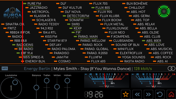](bilder/bedienung/radio-visualizer-analog-a.png) | [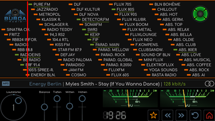](bilder/bedienung/radio-visualizer-analog-b.png) |
| Digitales VU-Meter | [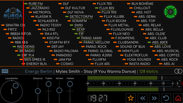](bilder/bedienung/radio-visualizer-digital-a.png) | [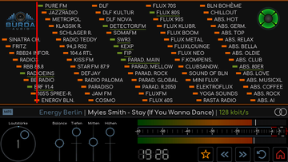](bilder/bedienung/radio-visualizer-digital-b.png) |
| Spektrumanalysator | [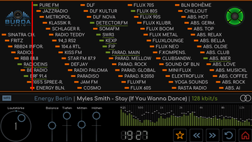](bilder/bedienung/radio-visualizer-spektrum-a.png) | [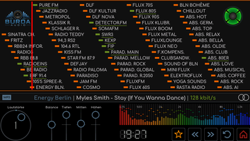](bilder/bedienung/radio-visualizer-spektrum-b.png) |
| Wellenform | [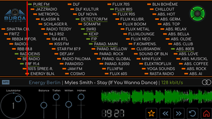](bilder/bedienung/radio-visualizer-welle-a.png) | [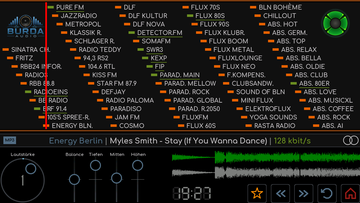](bilder/bedienung/radio-visualizer-welle-b.png) |
| Goniometer | [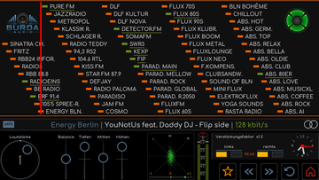](bilder/bedienung/radio-visualizer-goniometer-a.png) | [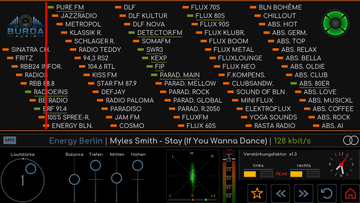](bilder/bedienung/radio-visualizer-goniometer-b.png) |
| Mittiges Spektrum | [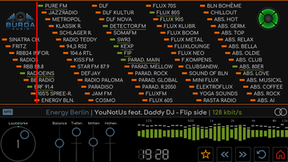](bilder/bedienung/radio-visualizer-mittig-a.png) | [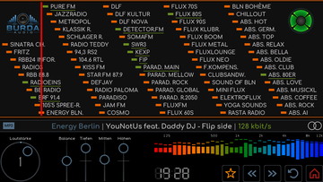](bilder/bedienung/radio-visualizer-mittig-b.png) |
| Wasserfall | [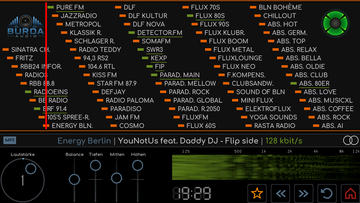](bilder/bedienung/radio-visualizer-wasserfall-a.png) | [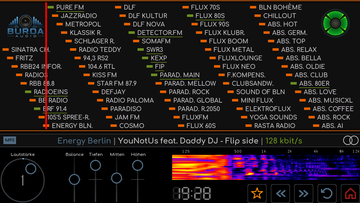](bilder/bedienung/radio-visualizer-wasserfall-b.png) |
| Nordlicht | [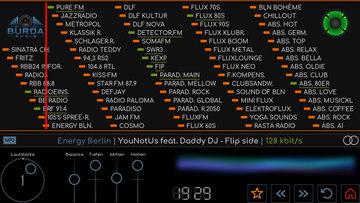](bilder/bedienung/radio-visualizer-nordlicht-a.png) | [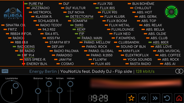](bilder/bedienung/radio-visualizer-nordlicht-b.png) |

Die Anzeigen folgen den Audiodaten. Bei angehaltener Wiedergabe, Stummschaltung oder sehr leisem Signal sind entsprechend wenige Ausschläge sichtbar. Während der Zeiger zu einem neuen Sender fährt, ruhen die Anzeigen.

## Vier magische Augen

Ein langer Druck auf das magische Auge oben rechts schaltet reihum durch **EM11, EM34, EM80 und EM84**. Dieselbe Wahl gibt es unter [Einstellungen -> Anzeige](Bedienung.md#anzeige-thema-und-bildschirm). Es ist eine grafische Nachbildung, keine zusätzliche Röhre.

Beim Senderwechsel begleitet das magische Auge die Zeigerfahrt. Sobald der Zeiger seine Zielposition erreicht hat, zeigt es die aktuelle WLAN-Signalstärke an: Je stärker das Signal, desto weiter schließt sich das Auge beziehungsweise wächst das Leuchtband. Der Wert wird etwa jede Sekunde aktualisiert, sodass auch Empfangsschwankungen bei laufendem Sender sichtbar werden. Ohne WLAN-Verbindung zeigt das Auge den minimalen Ausschlag. Angezeigt wird die Funkverbindung zum WLAN-Router.

| WLAN-Signalstärke | Ausschlag des magischen Auges |
| --- | --- |
| -55 dBm oder stärker | Vollständig geschlossen, 100 Prozent |
| -70 dBm | Halber Ausschlag, 50 Prozent |
| -85 dBm oder schwächer | Vollständig offen, 0 Prozent |

Zwischen diesen Werten ändert sich der Ausschlag stufenlos. Die vier Bauformen behalten ihre jeweils typische Darstellung.

| EM11 | EM34 | EM80 | EM84 |
| --- | --- | --- | --- |
|  |  | [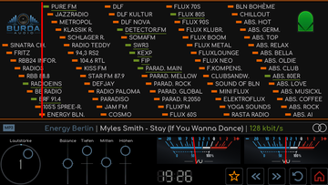](bilder/bedienung/radio-auge-3.png) | [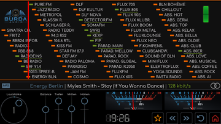](bilder/bedienung/radio-auge-4.png) |

## SD-Player

Der SD-Player verbindet eine animierte Kassette, Coveranzeige, Titelinformationen und eine scrollbare Titelliste. Die fünf Tasten unter der Kassette stehen für vorherigen Titel, Wiedergabe, Pause, Stop und nächsten Titel. Der Fortschritt zeigt verstrichene und gesamte Spielzeit des laufenden Titels. Ein Tipp in die Titelliste startet den betreffenden Titel. Radio und SD-Player spielen nie gleichzeitig: Startet der eine, stoppt der andere.

| Laufende Wiedergabe mit Cover | Pause | Noch keine Titel |
| --- | --- | --- |
| [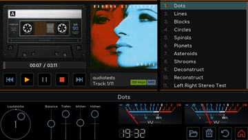](bilder/bedienung/sdplayer-cover-wiedergabe.png) | [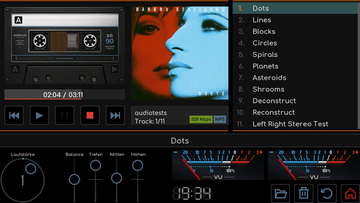](bilder/bedienung/sdplayer-pause.png) | [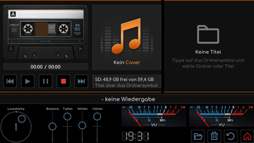](bilder/bedienung/sdplayer-uebersicht.png) |

Der SD-Player spielt Dateien mit den Endungen **MP3, AAC, M4A, FLAC und OGG**. Die Karte steckt im microSD-Kartenleser des Tab5 und wird beim Start eingebunden. Sie muss mit FAT32 formatiert sein, exFAT kann die Firmware nicht lesen. Karten ab 64 GB sind ab Werk meist mit exFAT formatiert und müssen vorher am Rechner auf FAT32 umformatiert werden. RetroRadioTab5 selbst formatiert eine Karte nie, auch nicht bei einem Lesefehler.

### Musik auswählen

Das **Ordnersymbol** öffnet die Dateiauswahl. Ein kurzer Tipp öffnet einen Ordner, **..** führt eine Ebene zurück. Dateien beziehungsweise ein ganzer Ordner lassen sich durch längeres Drücken auswählen, auch mehrere nacheinander. Die Auswahl wird unten zusammengefasst. **ok** übernimmt sie in die Titelliste, **abbruch** schließt den Dialog ohne Übernahme. Bereits enthaltene Dateien werden beim Hinzufügen übersprungen.

| Dateiauswahl | Musikordner | Albumordner | Ordner ausgewählt |
| --- | --- | --- | --- |
| [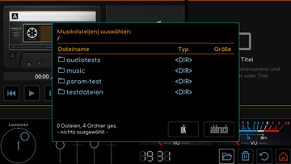](bilder/bedienung/sdplayer-dateiauswahl.png) | [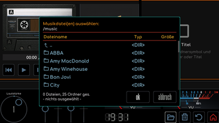](bilder/bedienung/sdplayer-musikordner.png) | [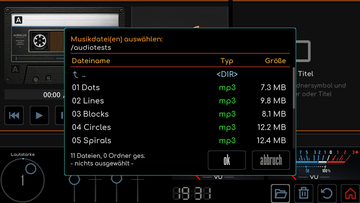](bilder/bedienung/sdplayer-albumauswahl.png) | [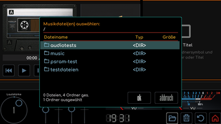](bilder/bedienung/sdplayer-ordner-ausgewaehlt.png) |

Ein ausgewählter Ordner bringt seine Titel nach Namen sortiert mit, danach die seiner Unterordner. Die Titelliste fasst höchstens 300 Einträge, gesammelt wird bis 20 Ordnerebenen tief. Wird eine Grenze erreicht, meldet der Dialog **Auswahlgrenze erreicht**. Verwaltungsdateien von Windows und macOS, etwa `._Titel.mp3`, `.DS_Store` oder `System Volume Information`, blendet die Dateiauswahl aus.

Die Titel werden über die Wiedergabetaste gestartet. Der **Papierkorb** entfernt nach der Rückfrage **LISTE LEEREN?** die Titelliste, nicht die Musikdateien auf der SD-Karte. Das Haus unten rechts öffnet wie im Radio den Sleep-Timer. Lautstärke, Balance, Klang, der **Kreispfeil** zum Zurücksetzen und Visualisierungswechsel funktionieren wie im Radio.

Die Abbildungen zeigen vorhandene Musikdateien und ein Cover zur Demonstration. Titel, Künstlernamen und Coverabbildungen dienen als Beispiele, Musikdateien sind nicht Bestandteil des Repositorys.

[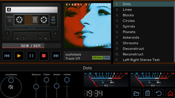](bilder/bedienung/sdplayer-lautstaerke-null.png)

### Wiedergabe wiederholen

Die Farbe der Play-Taste zeigt den gewählten Modus. Die Farben gelten für das Thema Retro, die anderen Themen verwenden eigene Töne.

| Farbe | Modus | Bedienung |
| --- | --- | --- |
| Orange | Normal | Die Liste wird einmal abgespielt. |
| Grün | Aktuellen Titel wiederholen | Während normaler laufender Wiedergabe kurz auf Play tippen. |
| Rot | Gesamte Wiedergabeliste wiederholen | Play mindestens 0,8 Sekunden halten und loslassen. |

Ein kurzer Druck auf Play während laufender Wiedergabe mit aktiver Wiederholung schaltet zurück auf normal, ohne dass der Titel neu beginnt. Pause, Titelsprünge und die Wahl eines Titels in der Liste behalten den Modus. Play setzt eine Pause mit dem gewählten Modus fort. **Stop**, der **Papierkorb** und das Verlassen des Players schalten die Wiederholung aus. Die Listenwiederholung umfasst auch eine Wiedergabeliste mit Titeln aus mehreren Ordnern. Die Wahl wird nicht gespeichert.

### Ordnercover und Bildgrenzen

Lege ein JPEG-Bild mit dem Namen **`folder.jpg`** in denselben Ordner wie die Musiktitel. Es hat Vorrang vor dem eingebetteten Cover und gilt für alle Titel dieses Ordners. Groß- und Kleinschreibung sind beliebig, beispielsweise funktioniert auch `Folder.JPG`. Eine `folder.png` wird nicht als Ordnerbild gesucht.

Fehlt das Ordnerbild oder ist es zu groß, beschädigt oder nicht ladbar, versucht der Player das eingebettete Cover. Ist auch dieses nicht nutzbar, erscheint der Platzhalter. Dafür wird kein Fehlerdialog geöffnet und die Wiedergabe nicht angehalten.

| Eigenschaft | Grenze oder Verhalten |
| --- | --- |
| Bildgröße | Höchstens 1 MB pro Bilddatei oder eingebettetem Cover. Die Größe der gesamten Musikdatei ist dafür unerheblich. |
| Eingebettetes Cover | JPEG oder PNG, ein PNG höchstens 500 x 500 Pixel. |
| Darstellung | 345 x 330 Pixel, ohne Verzerrung skaliert, überstehende Ränder werden mittig beschnitten. |

### Kassetten wechseln

Ein Tipp auf die Kassette wechselt zur nächsten der acht Gestaltungen. Die Wickel und Naben werden bei der Wiedergabe animiert. Die Bandwickel zeigen den Fortschritt der gesamten Wiedergabeliste. Jeder Titel belegt dabei einen gleich großen Anteil, hinzu kommt der laufende Fortschritt des aktuellen Titels. Am Listenende ist das Band vollständig rechts aufgewickelt. Die Wickel zeigen daher keine genaue Restspielzeit an. Die Gestaltung ändert nicht die Musikauswahl.

| Variante 1 | Variante 2 | Variante 3 | Variante 4 |
| --- | --- | --- | --- |
| [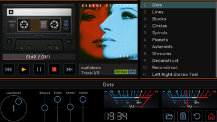](bilder/bedienung/sdplayer-kassette-1.png) | [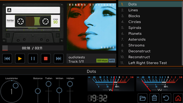](bilder/bedienung/sdplayer-kassette-2.png) | [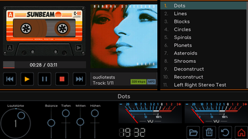](bilder/bedienung/sdplayer-kassette-3.png) | [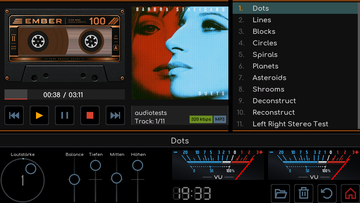](bilder/bedienung/sdplayer-kassette-4.png) |

| Variante 5 | Variante 6 | Variante 7 | Variante 8 |
| --- | --- | --- | --- |
| [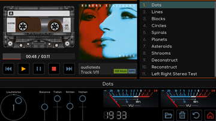](bilder/bedienung/sdplayer-kassette-5.png) | [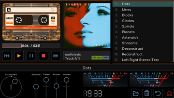](bilder/bedienung/sdplayer-kassette-6.png) | [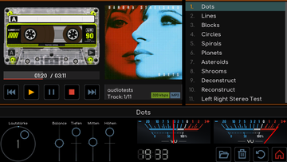](bilder/bedienung/sdplayer-kassette-7.png) | [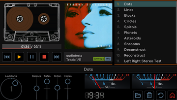](bilder/bedienung/sdplayer-kassette-8.png) |

## Dateien übertragen und Lautsprecher abschalten

Musik kann über einen Kartenleser auf die SD-Karte kopiert werden. Bei eingelegter Karte stehen zusätzlich die [Web-Dateiverwaltung und FTP](Weboberfläche.md#dateien-auf-der-sd-karte) zur Verfügung. Solange Dateimanager oder FTP auf die Karte zugreifen, startet der SD-Player keine Wiedergabe und meldet **Anforderung nicht angenommen**. Über **Einstellungen -> Klang -> Lautsprecher** schaltest Du den Ton ganz ab, ein eingesteckter Kopfhörer bringt den Ton an die Buchse statt an den Lautsprecher.

[RetroRadioTab5](../README.md) > [Dokumentation](../README.md#dokumentation) > Radio und Musik
