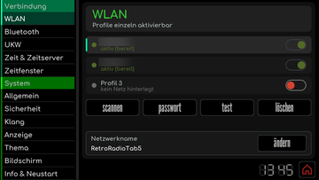
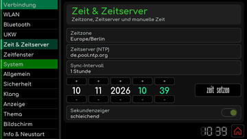

# RetroRadioTab5: Erste Inbetriebnahme

[RetroRadioTab5](../README.md) > [Dokumentation](../README.md#dokumentation) > RetroRadioTab5: Erste Inbetriebnahme

Diese Anleitung führt Dich vom fabrikneuen M5Stack Tab5 zum gestarteten RetroRadioTab5. Du bereitest das Projekt unter Windows, Linux oder macOS in Visual Studio Code mit PlatformIO vor und überträgst die Firmware über ein einziges USB-C-Kabel. Beim ersten Mal sichert der Upload zuerst die Werksfirmware des Tab5 auf Deinem Rechner. Danach kannst Du denselben Projektordner zum Lesen und Bearbeiten des Quellcodes und für spätere Aktualisierungen verwenden.

**Stand: 10.11.2026.** Der Ablauf wurde unter Linux praktisch bestätigt: Am 22.10.2026 wurden zwei Tab5 mit Werksfirmware, eines mit ST7123- und eines mit ST7121-Display, erstmals eingerichtet und danach mehrfach aktualisiert. Die Schritte für Windows und macOS stützen sich auf die offiziellen Software- und Treiberunterlagen, eigene Durchläufe auf diesen Systemen stehen noch aus. Der optionale Bluetooth-Sender wurde ebenfalls nur unter Linux geflasht.

> Beginne mit dem Tab5 allein, ohne Bluetooth-Sender am M5-Bus. Die ab Werk installierte Demo wird durch RetroRadioTab5 ersetzt, eine Zwischen-Firmware ist nicht erforderlich. Die Sicherung der Werksfirmware entsteht dabei automatisch.

## 1. Was Du brauchst

- Ein **M5Stack Tab5**. Alle drei Displayausführungen werden unterstützt, ein ESP32-P4 ab Chiprevision 3.0 nicht. Der Upload prüft das selbst, siehe [Welche Tab5 laufen](../README.md#welche-tab5-laufen).
- Ein USB-C-Datenkabel, passend zu Deinem Rechner. Ein reines Ladekabel reicht nicht.
- Einen Rechner mit Windows, Linux oder macOS und Internetzugang für den Download der Entwicklungswerkzeuge und Projektabhängigkeiten.
- Visual Studio Code mit der Erweiterung PlatformIO IDE sowie den vollständigen RetroRadioTab5-Projektordner.
- Ein WLAN im 2,4-GHz-Band für das Internetradio.
- Für den SD-Player eine microSD-Karte mit FAT32. Die Firmware kann kein exFAT lesen, Karten ab 64 GB sind ab Werk meist mit exFAT formatiert.

## 2. Visual Studio Code und PlatformIO einrichten

### Vorbereitung für Dein Betriebssystem

Installiere die Desktop-Ausgabe von [Visual Studio Code](https://code.visualstudio.com/download). Die folgenden Schritte werden in der lokal installierten Anwendung ausgeführt.

| Betriebssystem | Vorbereitung |
| --- | --- |
| Windows | Verwende das zu Deinem Rechner passende [VS-Code-Installationsprogramm](https://code.visualstudio.com/docs/setup/windows). Die Variante **User Setup** installiert VS Code für Dein Benutzerkonto. |
| Linux | Installiere das passende Paket gemäß der [VS-Code-Anleitung für Linux](https://code.visualstudio.com/docs/setup/linux), beispielsweise DEB unter Debian/Ubuntu oder RPM unter Fedora. Für PlatformIO werden Python 3 und die Unterstützung für virtuelle Python-Umgebungen benötigt, unter Debian/Ubuntu heißt das Zusatzpaket `python3-venv`. Installiere diese bei Bedarf über die Paketverwaltung Deiner Distribution. |
| macOS | Lade die passende Ausgabe für Deinen Mac herunter und verschiebe **Visual Studio Code.app** nach **Programme / Applications**. Die [VS-Code-Anleitung für macOS](https://code.visualstudio.com/docs/setup/mac) beschreibt die Installation. |

Für das Klonen des Projekts und spätere Git-Aktualisierungen benötigst Du zusätzlich [Git für Dein Betriebssystem](https://git-scm.com/install/). Falls Du Git gerade installiert hast, starte VS Code anschließend neu. In Abschnitt 3 ist auch die Beschaffung als ZIP-Datei beschrieben.

### PlatformIO installieren

1. Starte VS Code und öffne links **Erweiterungen / Extensions**.
2. Suche nach **PlatformIO IDE** und installiere die Erweiterung des Herausgebers **PlatformIO**.
3. Warte auf den Abschluss der Einrichtung und lade das VS-Code-Fenster neu, falls Du dazu aufgefordert wirst.

PlatformIO bringt seine Kommandozeilenwerkzeuge bereits mit. Für diesen Weg brauchst Du keine zusätzliche PlatformIO-Installation per `pip` oder Betriebssystempaket. Unter Linux nennt die [offizielle PlatformIO-Installationsanleitung](https://docs.platformio.org/en/latest/integration/ide/vscode.html#installation) außerdem `python3-venv` als Voraussetzung.

Die Menüs von VS Code können deutsch oder englisch heißen. PlatformIO verwendet überwiegend englische Bezeichnungen, diese sind hier so angegeben, wie sie in der Erweiterung stehen.

## 3. Das vollständige Projekt öffnen

### Empfohlen: direkt in VS Code klonen

1. Öffne das [RetroRadioTab5-Repository](https://github.com/DIYLAB-DE/RetroRadioTab5) im Browser. Kopiere über **Code > HTTPS** die Repository-Adresse.
2. Öffne in VS Code über **Ansicht / View > Befehlspalette / Command Palette** die Befehlsauswahl.
3. Wähle **Git: Clone** und füge die kopierte HTTPS-Adresse ein.
4. Wähle einen lokalen Zielordner. Öffne nach dem Klonen das Projekt in VS Code.

Dieser Weg entspricht dem [Klonen eines vorhandenen Repositorys in VS Code](https://code.visualstudio.com/docs/sourcecontrol/repos-remotes#clone-repositories). Du erhältst eine vollständige lokale Arbeitskopie, die Du später auch bearbeiten und mit **Git: Pull** aktualisieren kannst.

### Alternative: ZIP herunterladen

Wähle im Repository **Code > Download ZIP**, entpacke das Archiv vollständig und öffne den entpackten Projektordner über **Datei / File > Ordner öffnen / Open Folder** in VS Code. Wähle den Ordner, in dem `platformio.ini` liegt. Bei einer ZIP-Datei heißt dieser Ordner üblicherweise `RetroRadioTab5-master`.

### Den richtigen Ordner erkennen

Im Explorer von VS Code müssen unter anderem diese Einträge sichtbar sein:

| Eintrag | Inhalt |
| --- | --- |
| `platformio.ini` | Projekteinstellungen mit der Umgebung `tab5_basis` und festen Versionen. |
| `src` | C++-Quelldateien der Firmware. |
| `include` | Zugehörige Header-Dateien, Schriften und Bilder. |
| `boards` | Boarddefinition für das Tab5. |
| `lib` | Mitgelieferte Bibliotheken, darunter die angepasste Audio-Bibliothek. |
| `webui` | Quelle der Weboberfläche. |
| `bt-sender` | Eigenes kleines Projekt für die Firmware des optionalen Bluetooth-Senders. |

Öffne den vollständigen Projektordner, nicht nur eine einzelne Quelldatei oder den Unterordner `src`. Bestätige eine Vertrauensabfrage von VS Code nur für die von Dir bezogene und geprüfte Projektquelle. Warte anschließend, bis PlatformIO das Projekt erkannt und vorbereitet hat. Beim ersten Öffnen und Bauen werden weitere Pakete heruntergeladen. PlatformIO legt sie für dieses Projekt im Ordner `.pio-core` innerhalb des Projektordners ab, eine andere PlatformIO-Installation bleibt davon unberührt.

Zum Lesen oder Bearbeiten öffnest Du eine Datei im Explorer. Änderungen speicherst Du wie gewohnt in VS Code. Danach kannst Du die Firmware erneut bauen und übertragen. Für die Erstinstallation sind keine Änderungen am Quellcode, an den Bibliotheken oder an `platformio.ini` nötig.

## 4. Die Firmware zunächst bauen

Es gibt eine Projektumgebung für alle Tab5: `tab5_basis`. Sie ist voreingestellt, eine Auswahl ist nicht nötig.

Klicke links auf das PlatformIO-Symbol und öffne **Project Tasks**. Starte unter **tab5_basis > General > Build** den Build. Dabei wird aus dem Quellcode die Firmware erstellt. Das Tab5 muss hierfür noch nicht angeschlossen sein. PlatformIO lädt die in der Projektkonfiguration festgelegten Werkzeuge und Abhängigkeiten. Der erste Durchlauf kann deshalb deutlich länger dauern als spätere Builds. Die [PlatformIO-Dokumentation](https://docs.platformio.org/en/latest/integration/ide/vscode.html#project-tasks) beschreibt die Projektaufgaben.

Warte auf **SUCCESS**. Bei einem Fehler behebst Du zuerst dessen Ursache anhand der Ausgabe im Terminalbereich von VS Code. Fahre erst nach einem erfolgreichen Build mit der Übertragung fort.

## 5. Das Tab5 anschließen

1. Verbinde das Tab5 über das Datenkabel mit seiner **USB-C-Buchse** mit dem Rechner. Die USB-A-Buchse des Tab5 wird nicht verwendet.
2. Schalte das Tab5 ein, falls es nicht von selbst startet: einmal kurz auf die Ein-/Aus-Taste drücken.
3. Warte, bis das Betriebssystem den Anschluss erkannt hat.

Das Tab5 meldet sich als **USB JTAG/serial debug unit** mit der USB-Kennung **303A:1001**. Beschreibung und Portname hängen vom Betriebssystem ab:

| Betriebssystem | Beispiele für Portnamen | Zusätzliche Orientierung |
| --- | --- | --- |
| Windows | `COM5`, `COM6` | Im Geräte-Manager unter **Anschlüsse (COM & LPT)** nachsehen. |
| Linux | `/dev/ttyACM0` | Bei verweigertem Zugriff die Geräteberechtigungen prüfen, siehe Abschnitt 11. |
| macOS | `/dev/cu.usbmodem...` | Den nach dem Anstecken hinzugekommenen seriellen `/dev/cu.`-Anschluss wählen. |

Ist genau ein Tab5 angeschlossen, findet der Upload es selbst, eine Portauswahl ist dann nicht nötig. Er spricht ausschließlich Anschlüsse mit der Kennung 303A:1001 an, andere serielle Geräte am Rechner bleiben unberührt. Bei mehreren Tab5 wählst Du den Anschluss über die Befehlspalette mit **PlatformIO: Set Project Port (upload/monitor/test)** oder im Terminal mit `--upload-port`. Espressif beschreibt das [Erkennen des seriellen Anschlusses unter Windows, Linux und macOS](https://docs.espressif.com/projects/esp-idf/en/stable/esp32p4/get-started/establish-serial-connection.html).

## 6. Der geschützte Upload

RetroRadioTab5 verwendet nicht den gewöhnlichen Upload von PlatformIO, sondern einen eigenen, geprüften Ablauf. Er liest vor jedem Schreiben die Chiprevision des ESP32-P4 und die Partitionstabelle des Geräts:

| Gerät | Was der Upload tut |
| --- | --- |
| Falsche Chiprevision | Bricht ab, bevor etwas geschrieben wird. |
| Tab5 mit Werksfirmware | Bricht ab und nennt die gefundene Tabelle, solange Du die Erstinstallation nicht ausdrücklich freigibst (Abschnitt 7). |
| Tab5 mit RetroRadioTab5 | Schreibt nur die Firmware, prüft sie und stellt erst danach die Tabelle um. Einstellungen, PIN, WLAN-Zugangsdaten und Sender bleiben erhalten. |

Die Firmware des WLAN-Chips ESP32-C6 im Tab5 wird in keinem Fall verändert.

## 7. RetroRadioTab5 erstmals übertragen

Die Erstinstallation auf einem Tab5 mit Werksfirmware gibst Du einmalig mit der Umgebungsvariablen `TAB5_ERSTFLASH=1` frei. Das geht im Terminal. Öffne im Projekt über die Befehlspalette **PlatformIO: New Terminal**. Dieses Terminal verwendet die mit PlatformIO eingerichteten Werkzeuge. Zur Kontrolle meldet `pio --version` dort PlatformIO Core 6.1 oder neuer. Schließe vorher offene serielle Monitore, damit sie den Anschluss nicht belegen.

**Linux und macOS:**

```text
TAB5_ERSTFLASH=1 pio run -e tab5_basis -t upload
```

**Windows, PowerShell** (Voreinstellung des Terminals in VS Code):

```text
$env:TAB5_ERSTFLASH="1"; pio run -e tab5_basis -t upload; Remove-Item Env:TAB5_ERSTFLASH
```

**Windows, Eingabeaufforderung:** die drei Zeilen nacheinander eingeben.

```text
set TAB5_ERSTFLASH=1
pio run -e tab5_basis -t upload
set TAB5_ERSTFLASH=
```

Bei mehreren angeschlossenen Tab5 hängst Du `--upload-port` mit dem Anschluss an, etwa `--upload-port COM5`. Der Upload läuft dann so ab:

1. Er liest Chiprevision und Partitionstabelle und erkennt die Werksfirmware.
2. Er sichert den **gesamten Flash von 16 MB** in den Projektordner unter `.pio/recovery/werk_<Kennung>/`. Die Kennung ist die Hardwareadresse des Tab5. Neben dem Abbild `flash_16MiB.bin` liegen die Chipangaben und Prüfsummen. Das dauert etwa eine bis zwei Minuten.
3. Er löscht den Einstellungsbereich und den Senderspeicher und schreibt Bootloader, Partitionstabelle und Firmware.
4. Er prüft die geschriebene Firmware und startet das Tab5 neu.

Warte auf **SUCCESS** und trenne währenddessen das Kabel nicht. Danach erscheint der Sperrbildschirm von RetroRadioTab5.

> **Bewahre die Sicherung gut auf.** Kopiere den Ordner `.pio/recovery/werk_<Kennung>/` an einen sicheren Ort außerhalb des Projekts. Er ist Dein Rückweg zur Werksfirmware: Das Abbild lässt sich mit esptool an Adresse `0x0` zurückschreiben, etwa `esptool --chip esp32p4 --port <Anschluss> write-flash 0x0 flash_16MiB.bin`. Dieser Rückweg ist nicht automatisiert und nicht praktisch geprüft.

Bricht die Verbindung beim Lesen ab, versetze das Tab5 von Hand in den Download-Modus: Halte die Ein-/Aus-Taste gedrückt, bis die grüne LED blinkt, und lass sie dann los. Starte den Upload erneut und schalte das Tab5 danach einmal aus und wieder ein.

## 8. Spätere Updates

Für jedes weitere Update reicht der gewöhnliche Weg ohne Umgebungsvariable:

1. Neuen Quellstand holen: im geklonten Projekt mit **Git: Pull**, sonst die neue ZIP-Datei entpacken.
2. In **Project Tasks > tab5_basis > General > Upload** starten oder im Terminal `pio run -e tab5_basis -t upload` eingeben.
3. Auf **SUCCESS** warten. Das Tab5 startet mit der neuen Firmware neu.

Einstellungen, PIN, WLAN-Zugangsdaten und Sender bleiben dabei erhalten. Die Versionsnummer unter **Einstellungen -> Info & Neustart** ändert sich nur mit einem Release, ein eigener Build aus demselben Quellstand zeigt dieselbe Nummer. Was sich geändert hat, steht unter [Änderungen](Änderungen.md).

## 9. Erster Start und Grundeinstellungen

### Entsperren

Ab Werk ist die PIN-Sperre eingeschaltet. Tippe auf den Sperrbildschirm, gib die Start-PIN **`0000`** ein und bestätige mit **ok**. Danach erscheint das Hauptmenü. Die Oberfläche ist deutsch, die Zeitzone steht auf Europe/Berlin und der Zeitserver auf `de.pool.ntp.org`.

### WLAN einrichten

1. Öffne **Einstellungen -> WLAN** und wähle ein Profil.
2. Tippe auf **scannen**, wähle Dein Netzwerk und gib über **passwort** das zugehörige Passwort ein.
3. Führe **test** aus und kontrolliere den erfolgreichen Verbindungsaufbau. Prüfe, dass das Profil über seinen Schalter aktiviert ist.
4. Tippe auf **speichern** und wähle im anschließenden Dialog **neustart**, damit die gespeicherten Änderungen übernommen werden.

Die WLAN-Zugangsdaten werden am Gerät eingerichtet. Für die Installation brauchst Du keine eigenen Zugangsdaten in den Projektdateien einzutragen.

### Zeit, PIN und Sprache

1. Prüfe unter **Einstellungen -> Zeit & Zeitserver** Zeitzone und Zeitserver. Sobald das WLAN steht, gleicht das Tab5 die Uhrzeit ab und zeigt im Hauptmenü die Marke **NTP**.
2. Ändere unter **Einstellungen -> Sicherheit** die Start-PIN oder schalte die Sperre aus. Merke Dir eine eigene PIN gut, ohne sie lässt sich die Sperre nicht aufheben.
3. Unter **Einstellungen -> Allgemein** wählst Du bei Bedarf English als Sprache.

| WLAN einrichten | Zeit einstellen |
| --- | --- |
| [](bilder/bedienung/einstellungen-wlan.png) | [](bilder/bedienung/einstellungen-zeit.png) |

### SD-Karte und Weboberfläche

Kopiere Deine Musik am Rechner auf eine microSD-Karte mit FAT32, am besten in einen Ordner je Album. Schalte das Tab5 aus, stecke die Karte ein und schalte es wieder ein. Im SD-Player öffnet das **Ordnersymbol** die Dateiauswahl, wie im Abschnitt [SD-Player](Radio-und-Musik.md#sd-player) beschrieben.

Die IP-Adresse des Tab5 steht im Zifferblatt des Hauptmenüs. Öffne sie im Browser mit `http://` davor, dort pflegst Du Sender und Dateien, siehe [Weboberfläche](Weboberfläche.md).

## 10. Den Bluetooth-Sender ergänzen

Der Bluetooth-Sender ist optional. Wenn RetroRadioTab5 läuft, flashst Du den M5Stamp Pico am Programmieradapter und verdrahtest ihn danach mit dem M5-Bus des Tab5:

1. Pico flashen, wie unter [Pico flashen](Bluetooth-Sender.md#pico-flashen) beschrieben. Dafür nutzt Du dasselbe Projekt und dasselbe PlatformIO-Terminal.
2. Tab5 ausschalten und den Pico nach dem [Verdrahtungsplan](Bluetooth-Sender.md#verdrahtung) anschließen.
3. Tab5 einschalten und unter **Einstellungen -> Bluetooth** Deinen Kopfhörer [koppeln](Bluetooth-Sender.md#koppeln).

## 11. Hilfe bei Problemen

### PlatformIO erkennt das Projekt nicht

Prüfe, ob Du den entpackten oder geklonten Ordner mit `platformio.ini` geöffnet hast. Ein übergeordneter Downloadordner oder nur `src` reicht nicht. Kontrolliere außerdem, ob die PlatformIO-Erweiterung fertig eingerichtet ist und der Arbeitsbereich für diese Projektquelle freigegeben wurde. Lade das VS-Code-Fenster bei Bedarf neu.

### Kein passender serieller Anschluss erscheint

Prüfe Datenkabel und Buchse. Verbinde das Tab5 möglichst direkt mit dem Rechner, nicht über einen USB-Verteiler. Prüfe, ob das Tab5 eingeschaltet ist.

- **Windows:** Prüfe im Geräte-Manager, ob unter **Anschlüsse (COM & LPT)** ein neuer Anschluss erscheint, wenn Du das Tab5 ansteckst. Der Anschluss des ESP32-P4 nutzt den in Windows enthaltenen Treiber für serielle USB-Geräte.
- **macOS:** Prüfe mit `ls /dev/cu.*` im Terminal, ob nach dem Anstecken ein `/dev/cu.usbmodem`-Anschluss hinzugekommen ist.
- **Linux:** Prüfe, ob ein `/dev/ttyACM...`-Anschluss hinzugekommen ist. Ein sichtbarer Anschluss mit verweigertem Zugriff ist ein Berechtigungsproblem, siehe den folgenden Abschnitt.

### Unter Linux wird der Zugriff verweigert

Bei `Permission denied` richte die [PlatformIO-Geräteberechtigungen unter Linux](https://docs.platformio.org/en/latest/core/installation/udev-rules.html) für Deine Distribution ein. Die offizielle Anleitung beschreibt udev-Regeln und alternativ die passende Gruppenmitgliedschaft. Nach geänderten Regeln das Tab5 abziehen und neu verbinden. Nach einer Änderung der Gruppenmitgliedschaft zusätzlich ab- und wieder anmelden. Starte VS Code oder PlatformIO nicht ersatzweise mit `sudo`.

### Der Upload bricht mit einer Meldung ab

| Meldung | Bedeutung |
| --- | --- |
| **Gerätetabelle ist nicht das RetroRadioTab5-Layout** | Das Tab5 trägt noch die Werksfirmware. Führe die Erstinstallation aus Abschnitt 7 mit `TAB5_ERSTFLASH=1` aus. |
| **Chiprevision ... liegt außerhalb von v0.1 bis v1.99** | Der ESP32-P4 dieses Tab5 wird nicht unterstützt. Es wurde nichts geschrieben. |
| **Mehrere Tab5 am USB** | Wähle den Anschluss mit `--upload-port` oder **Set Project Port**. |
| **Kein Tab5 am USB gefunden** | Kabel, Buchse und Einschaltzustand prüfen, siehe oben. |

### Der Upload bleibt bei der Verbindungsaufnahme hängen

Schließe serielle Monitore und andere Programme, die auf denselben Port zugreifen. Versetze das Tab5 wie in Abschnitt 7 beschrieben in den Download-Modus und starte den Upload erneut.

### `pio` wird nicht gefunden

Verwende das in Abschnitt 7 beschriebene PlatformIO-Terminal in VS Code und warte, bis die Erweiterung fertig eingerichtet ist. Ein gewöhnliches Systemterminal kennt den Installationspfad möglicherweise noch nicht. Dafür ist keine zweite PlatformIO-Installation erforderlich. Für die Nutzung außerhalb von VS Code beschreibt PlatformIO die [Einrichtung der Shell-Befehle](https://docs.platformio.org/en/latest/core/installation/shell-commands.html).

### `pio` bricht mit `resultcallback` ab

Erscheint nach dem Befehl ein langer Python-Fehler mit `platformio==4.3.4`, `/usr/bin/pio` und `resultcallback`, startet das Terminal ein veraltetes PlatformIO aus den Paketquellen der Linux-Distribution, etwa bei Linux Mint oder Ubuntu. Es passt nicht zu aktuellen Python-Bibliotheken und bricht schon beim Start ab, bevor es das Tab5 anspricht. Der Build über VS Code gelingt trotzdem, weil die Erweiterung ihr eigenes PlatformIO verwendet. Öffne das Terminal über **PlatformIO: New Terminal** und prüfe mit `pio --version`, dass dort 6.1 oder neuer erscheint. Alternativ rufst Du das PlatformIO der Erweiterung mit vollem Pfad auf:

```text
TAB5_ERSTFLASH=1 ~/.platformio/penv/bin/pio run -e tab5_basis -t upload
```

Das veraltete Paket entfernst Du mit `sudo apt remove platformio`. Die PlatformIO-Erweiterung in VS Code bleibt davon unberührt.

### Der Build schlägt beim Download von Paketen fehl

Prüfe die Internetverbindung und die Fehlermeldung im Terminalbereich. Bei einem verwalteten Rechner können ein Proxy oder eingeschränkte Downloadrechte die Einrichtung verhindern. Die benötigten Bibliotheks- und Plattformversionen stehen bereits in `platformio.ini`. Ersetze sie nicht pauschal durch andere Versionen.

## Technischer Hintergrund und Prüfstand

Der geschützte Upload ist in `scripts/tab5_upload.py` und `scripts/flash_tab5.py` umgesetzt und in `platformio.ini` eingebunden. Der gewöhnliche Upload von PlatformIO würde zusätzliche Daten in den Einstellungsbereich schreiben, deshalb ist er ersetzt. Die Partitionstabelle steht in [partitions_tab5.csv](../partitions_tab5.csv). Die Firmware ist für die ESP32-P4-Chiprevisionen 0.x bis 1.x gebaut, ein Gerät mit Revision 3.x bräuchte andere vorkompilierte Bibliotheken des Arduino-Kerns. Die Displayausführung erkennt die Grafikbibliothek M5GFX bei jedem Start selbst, die [Hinweise von M5Stack zum Displaywechsel](https://docs.m5stack.com/en/core/Tab5) beschreiben die drei Ausführungen.

Die Erstinstallation wurde unter Linux an zwei Tab5 mit Werksfirmware und ESP32-P4 Revision 1.3 geprüft, eines mit ST7123- und eines mit ST7121-Display. Updates wurden unter Linux an allen drei Displayausführungen ausgeführt. Die Hinweise für Windows und macOS basieren auf den offiziellen Software- und Treiberunterlagen. Ein vollständiger Installationsdurchlauf unter diesen Systemen steht noch aus.

[RetroRadioTab5](../README.md) > [Dokumentation](../README.md#dokumentation) > RetroRadioTab5: Erste Inbetriebnahme
