# Weboberfläche

[RetroRadioTab5](../README.md) > [Dokumentation](../README.md#dokumentation) > Weboberfläche

Verbinde Rechner und Tab5 mit demselben erreichbaren Netzwerk. Die IP-Adresse des Tab5 steht im Zifferblatt des Hauptmenüs und unter **Einstellungen -> Info & Neustart**. Öffne diese Adresse im Browser mit `http://` davor, also etwa `http://192.168.1.50`. Bei eingeschalteter PIN-Sperre gib den am Gerät eingestellten vierstelligen Code auf dem Tastenfeld ein und bestätige mit **ok**, **c** löscht die Eingabe. Die voreingestellte Start-PIN lautet **`0000`**. Falls Du den Code bereits geändert hast, verwende Deinen eigenen. Die Oberfläche funktioniert im Browser unter Windows, Linux und macOS und braucht keine Verbindung ins Internet.

[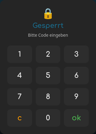](bilder/web/sperre.png)

Nach fünf falschen Eingaben wartet die Oberfläche eine Minute, bevor sie den nächsten Versuch annimmt. Jeder weitere Fehlversuch verdoppelt die Wartezeit bis höchstens 60 Minuten, die Sperrkarte zählt sie herunter. Eine Anmeldung gilt 30 Minuten. Sperrt sich das Gerät selbst, etwa durch die Ecken-Geste, ist auch der Browser wieder abgemeldet.

Die Navigationsleiste springt zu den einzelnen Bereichen derselben Seite: **Status**, **Radiosteuerung**, **System**, **Thema**, **Dateien** und **Screenshot**. Bei eingeschalteter PIN-Sperre sperrt das Schloss die Browseransicht wieder. Mit dem Mond- beziehungsweise Sonnensymbol wechselst Du zwischen heller und dunkler Darstellung, unten stehen sechs Farbschemata zur Wahl. Die Browseransicht merkt sich diese Auswahl. Sie ändert nur den Browser, nicht das Thema am Gerät. Alle Webaufnahmen dieser Anleitung zeigen die dunkle Darstellung.

## Status

Der Status zeigt WLAN-Verbindung, Zeitsynchronisation und Systemdaten. Hier lassen sich unter anderem Flashgröße, Firmwareversion, freie Ressourcen und die letzte Zeitsynchronisation ablesen. Netzwerkangaben sind in den Abbildungen unkenntlich gemacht.

[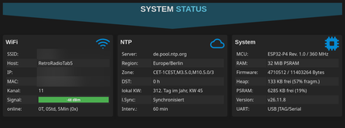](bilder/web/status.png)

## Radiosteuerung und Senderpflege

Die Radiosteuerung erscheint, wenn das **Radio am Gerät geöffnet** ist. Sie zeigt aktuellen Sender, Titel und Favoriten sowie die Senderskala. Die Regler ändern Lautstärke, Balance, Tiefen, Mitten und Höhen. Die beiden Pfeile wechseln den Sender, die Lautsprechertaste schaltet stumm beziehungsweise wieder hörbar.

[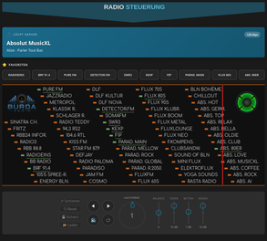](bilder/web/radio.png)

Klicke den kleinen farbigen **Sendermarker** auf der Skala an. Die Aktionsleiste bietet Aufrufen, Bearbeiten und Löschen. Am Rechner öffnet ein Einfachklick das Menü, ein Doppelklick startet den Sender. Auf dem Touchscreen öffnet der erste Tipp das Menü, der zweite Tipp auf denselben Sender startet ihn. Im Bearbeitungsdialog stehen Kurzname für die Skala, vollständiger Name, Stream-Adresse und Favoritenmarkierung. Höchstens zehn Sender können Favoriten sein. **Speichern** übernimmt die Änderung, **Abbrechen** verwirft sie. Verwende eine tatsächlich erreichbare Audio-Stream-Adresse, eine Webseite ersetzt keinen Stream. HTTP- und HTTPS-Streams werden unterstützt. Bei HTTPS muss das Serverzertifikat akzeptiert werden können, außerdem muss die Gerätezeit stimmen.

[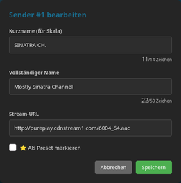](bilder/web/sender-bearbeiten.png)

### Sender sortieren

**Sortieren** öffnet die Liste aller 70 Senderplätze. Ziehe einen Eintrag am Griff auf seinen neuen Platz. Am oberen und unteren Listenrand scrollt die Liste automatisch weiter. Alternativ klickst oder tippst Du den Sender an, gibst einen Zielplatz von 1 bis 70 ein und bestätigst mit **Übernehmen**. Die Einträge dazwischen rücken nach, es wird kein Sender überschrieben. **Zurück** führt ohne Übernahme der Zielplatzwahl zur Liste.

Sendernamen, Streamadressen und Favoriten werden gemeinsam verschoben. Auch der laufende Sender bleibt seinem Eintrag zugeordnet und spielt weiter. Erst **Speichern** übernimmt die gesamte neue Reihenfolge auf das Tab5. **Abbrechen** verwirft alle Änderungen im Dialog. Hat sich die Senderliste währenddessen anderweitig geändert, wird die veraltete Reihenfolge nicht gespeichert. Öffne den Dialog dann erneut.

| Liste sortieren | Zielplatz wählen |
| --- | --- |
| [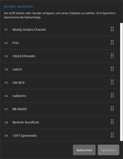](bilder/web/sender-sortieren.png) | [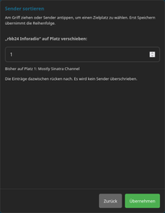](bilder/web/sender-zielplatz.png) |

### Sender sichern und wiederherstellen

**Sichern** lädt alle 70 Senderplätze einschließlich der Favoriten als Datei `retroradio-sender_JJJJ-MM-TT.json` herunter. Die Datei enthält keine gerätebezogenen Daten und lässt sich auf RetroRadioTab5 und RetroRadio laden. WLAN-Zugangsdaten gehören nicht dazu.

Mit **Laden** wählst Du eine Sicherungsdatei aus. Die Weboberfläche prüft die Datei und zeigt Dir die Zahl der belegten Plätze und Favoriten. Erst wenn Du bestätigst, ersetzt sie die gesamte Liste. Bei einem Fehler gibt die Meldung den betroffenen Platz oder die Zeile und Spalte an. Nach dem Laden kann der laufende Sender kurz neu starten.

**Reset** bei der Senderliste stellt die Werkssender wieder her und überschreibt die eigene Liste. Die getrennte EQ-Rücksetztaste setzt nur die Klangregelung zurück.

## Systemeinstellungen

Hier richtest Du Zeitzone, Zeitserver, Sync-Intervall, Sprache und Netzwerknamen ein. Die Browser-Zeit kann in das Eingabefeld übernommen und mit **Zeit setzen** an das Gerät übergeben werden.

Unter **Netzwerkname** und **Sprache** zeigt die Zeile **PIN-Sperre für Radio und Web**, ob die Sperre ein- oder ausgeschaltet ist. Klicke auf **Ein**, gib Deine aktuelle PIN ein und bestätige mit **Ausschalten**. Mit **Aus** schaltest Du die Sperre sofort wieder ein. Dann gilt wieder Deine bisherige PIN. Unter **PIN ändern** gibst Du die aktuelle und die neue vierstellige PIN ein. Mit **Speichern** gilt die neue PIN sofort, auch am Gerät.

[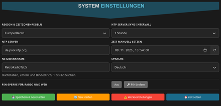](bilder/web/system.png)

**Speichern & neu starten** übernimmt die Systemeinstellungen und startet das Tab5 neu. **Neu starten** und **Werkseinstellungen** sind eigene Aktionen. Ein Zurücksetzen löscht persönliche Einstellungen, es ist kein normaler Schritt für ein Firmware-Update.

## Thema und Farben

Der Bereich **Thema & Farben** zeigt die drei Themen des Geräts als Kacheln mit Vorschaubild: **Retro**, **E-Paper** und **Individuell**. Das laufende Thema trägt **aktiv**. Wählst Du **Individuell**, erscheint darunter **Individuelle Farben** mit 18 Grundfarben in den Gruppen **Akzente**, **Text** und **Erweitert**, Grund und Fläche bleiben fest. Die Vorschau färbt das Radiobild sofort mit Deinen Farben ein. **Vorgabe wiederherstellen** setzt die Farben zurück.

[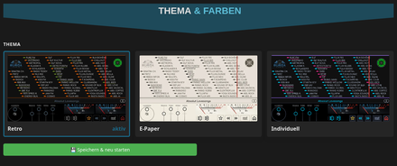](bilder/web/thema-farben.png)

**Speichern & neu starten** übernimmt Thema und Farben und startet das Tab5 neu, denn das Gerät wechselt das Thema nur beim Start. Dieselbe Themenwahl gibt es am Gerät unter [Einstellungen -> Thema](Bedienung.md#anzeige-thema-und-bildschirm), die Farben von Individuell nur hier.

## Dateien auf der SD-Karte

Der Dateimanager zeigt Ordner und Dateien der eingelegten Karte. Öffne Ordner durch Anklicken. Über die Pfadleiste gelangst Du zurück. Dateien lassen sich über die Upload-Fläche auswählen oder hineinziehen, je Datei bis 32 MiB. Gibt es den Namen schon, fragt die Seite, ob die vorhandene Datei ersetzt werden soll. Die Aktionen an einem Eintrag dienen zum Umbenennen beziehungsweise Löschen, **Neuer Ordner** legt einen Ordner im angezeigten Pfad an. Einen Ordner mit Inhalt zählt die Seite vor dem Löschen durch und fragt mit der Zahl der Dateien und Ordner nach. Verwaltungsdateien von Windows und macOS werden nicht angezeigt.

[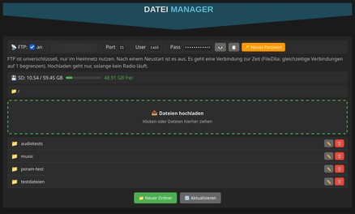](bilder/web/dateien.png)

Während der SD-Player abspielt, sind Dateimanager und FTP für die Karte gesperrt. Umgekehrt startet der SD-Player nicht, solange Dateimanager oder FTP auf die Karte zugreifen. Verwende eigene Musikdateien und halte vor dem Löschen oder Ersetzen eine Sicherung vor. Das Projekt enthält keine Musiksammlung. Für die Ordnerauswahl und Coveranzeige am Gerät siehe [SD-Player](Radio-und-Musik.md#sd-player).

### FTP

Über dem Dateimanager steht die FTP-Zeile mit Adresse, Port, Benutzer und Passwort. Mit ihrem Schalter schaltest Du FTP ein oder aus. Nach jedem Neustart des Tab5 ist FTP aus. Der Benutzer heißt **`tab5`**, das Passwort erzeugt das Gerät selbst. **Passwort anzeigen** blendet es ein, **Passwort kopieren** legt es in die Zwischenablage, **Neues Passwort** erzeugt nach einer Rückfrage ein neues und trennt eine bestehende Verbindung. Die Zeile **FTP** unter **Einstellungen -> Info & Neustart** zeigt, ob FTP läuft, das Passwort steht nur hier.

[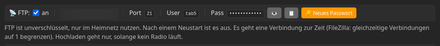](bilder/web/ftp.png)

Für ein FTP-Programm wie FileZilla gilt:

| Einstellung | Wert |
| --- | --- |
| Server | IP-Adresse des Tab5, Port 21 |
| Verschlüsselung | Nur unverschlüsseltes FTP |
| Übertragungsmodus | Passiv, das Tab5 nutzt die Ports 50000 bis 50003 |
| Verbindungen | Eine zur Zeit. In FileZilla die Zahl gleichzeitiger Verbindungen im Servermanager auf 1 begrenzen. |
| Hochladen | Nur, solange kein Radio läuft, auch kein stummes. Herunterladen geht immer. |

Das Tab5 nimmt FTP-Verbindungen nur aus dem eigenen Netzwerk an. Nach drei falschen Passwörtern trennt es die Verbindung, wiederholte Fehlversuche verlängern die Wartezeit wie bei der Weboberfläche. Ein abgebrochenes Hochladen hinterlässt keine halbe Datei und lässt eine vorhandene Datei gleichen Namens unverändert.

## Display aufnehmen

**Screenshot laden** liest das aktuelle Gerätebild mit 1280 x 720 Pixeln ein. Warte, bis die Vorschau vollständig erscheint. Danach speichert **Als PNG speichern** die Aufnahme auf dem Rechner. Während der Übertragung steht die Anzeige am Gerät kurz still, die Wiedergabe läuft weiter. Ein neues Bild wird erst nach einem erneuten Laden abgerufen. Die Vorschau ist kein Livevideo.

[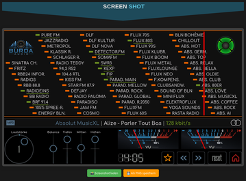](bilder/web/screenshot.png)

## Netzwerkzugriff

Weboberfläche und FTP sind für das eigene vertrauenswürdige Netzwerk vorgesehen. Der Sperrcode sperrt die Browseransicht, er stellt keine umfassende Anmeldung für sämtliche Geräteschnittstellen dar. HTTP und FTP übertragen unverschlüsselt. Richte keine öffentliche Portweiterleitung zum Tab5 ein. Die Weboberfläche antwortet nur auf ihre IP-Adresse und ihren Netzwerknamen, Namen aus anderen Quellen weist sie ab.

[Zur Gerätebedienung](Bedienung.md) | [Fehlerhilfe](Fehlerhilfe.md)

[RetroRadioTab5](../README.md) > [Dokumentation](../README.md#dokumentation) > Weboberfläche
